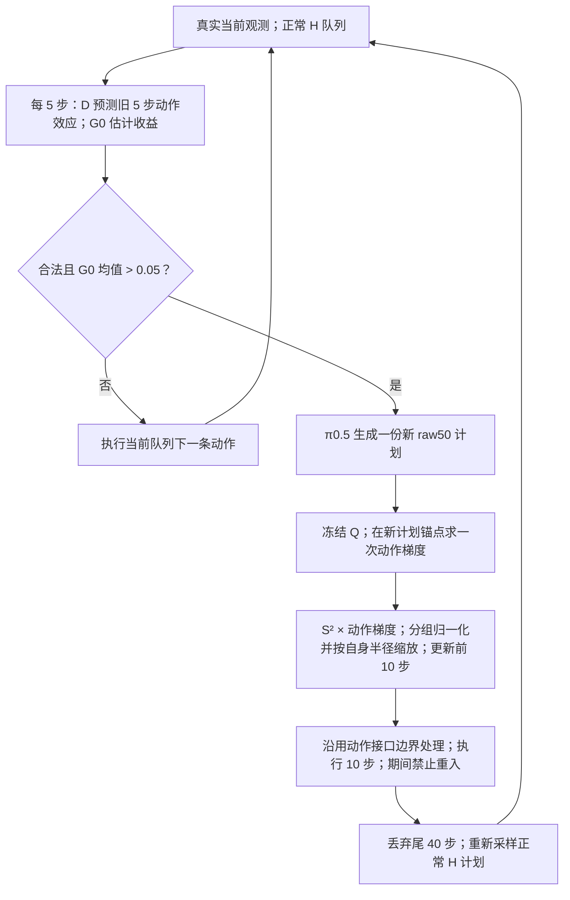

# 收益触发的重规划与单步动作纠偏

**更新日期：2026-09-25。当前在线定义：L11 完整 Q 网络、单次动作生成、单方向自身半径缩放、G0 多次触发。**

本文按本次确认的单步纠偏定义整理，覆盖辅助网络、训练目标、在线判定、动作更新和执行时序。主要接口口径为 **π0.5＋MetaWorld**；正常规划长度为 $H\in\{10,20,30,40,50\}$，干预承诺长度固定为 $C=10$。单次触发是对照配置，当前主线不限制每个 episode 的总干预次数。每次干预生成一份新计划，以 $S^2\odot\nabla_a J$ 为方向，按 XYZ 和夹爪各自的可行半径缩放后，加到前 10 步动作。

本文保留已有辅助网络和 L11 权重的训练来源。当前在线流程采用独立方向的 RMS 归一化与自身半径缩放，不生成 Velocity 或 Direct 动作，也不读取它们的方向、半径或评分。历史记录中的 `Post` 是采样后纠偏的实验标识，本文以“单步动作纠偏”描述当前方法。已归档实现及附录对照对应各自执行版本，具体数据见 [历史 Post 数据文档](EXPERIMENT_FOR_POST.md) 和 [实验总表](EXPERIMENT_RESULTS_MASTER.md)。

后续多任务重训按隐藏宽度确定容量：G0 隐藏宽度为 256，每成员约 3.23M、两个成员；Q 基础宽度为 512，每成员约 3.78M、四个成员；D 保留两个成员，以 256、512、768、1024、1536 五档隐藏宽度开展消融，再计算各档参数量。结构与参数计数见 [容量消融附录](APPENDIX_MODEL_CAPACITY_ABLATION_ZH.md)。下文已有权重的结构、参数量和实测记录仍对应其原始训练版本。

## 1. 方法概览与当前配置

方法流程是：**预测换计划是否有收益 → 必要时生成一份新计划 → 用冻结 Q 对已生成动作求一次梯度 → 对 $S^2$ 缩放后的方向计算自身半径并形成增量 → 经动作接口执行 10 步，再恢复正常规划。**

| 模块 | 作用 | 当前状态 |
|---|---|---|
| 基础策略 π0.5 | 当前观测、任务指令 → 50 步动作计划 | MT50 SFT030000，部署时冻结 |
| 世界模型 D | 因果历史、旧队列接下来 5 步动作 → 预测未来特征 | 冻结的两成员模型 |
| 收益模型 G0 | 当前历史、旧 5 步动作及 D 的预测效应 → 换计划收益 | 冻结的两成员模型；均值严格大于 0.05 才允许收益触发 |
| 动作 critic Q | 因果历史、新计划锚点、候选 10 步动作 → 终局成功概率估计 | 当前 L11 四成员；完整网络重新训练后冻结 |

G0 决定**何时换计划**，Q 提供**怎样修改新计划**的动作方向。局部配对数据是训练监督来源，不单列为本文的方法创新。

| 配置项 | 当前值或规则 |
|---|---|
| Q 损失 | **L11：BCE＋gain＋0.5pair** |
| 正式 Q 权重 | `L11_s9101`；成员 1041、1042、1043、1044 |
| 一次策略生成 | 完整 raw 计划 $50\times4$，原生采样 10 次 flow 步 |
| 一次纠偏更新 | 方向 $v=S^2\odot g_a$；分组屏蔽、RMS 归一化和自身半径缩放后，加到新计划前 10 步 |
| 分组目标 RMS / 单坐标增量上限 | XYZ：0.05 / 0.15；夹爪：0.10 / 0.40 |
| 边界余量 / 半径内缩 | 余量不足 0.05 的坐标不修改；半径乘 $1-10^{-6}$ |
| 动作边界处理 | 沿用正常动作接口的处理规则 |
| 正常执行长度 $H$ | 10 / 20 / 30 / 40 / 50；每个实验固定一种 |
| G0 监测间隔 | 每 5 个环境控制步 |
| 干预承诺长度 $C$ | 10；承诺期间不再监测或重入 |
| episode 总预算 $T$ | 300 个控制步；干预后不重新计时 |
| 默认触发次数限制 | 无总次数帽；仍须满足每次触发的全部合法性条件 |
| 干预后恢复 | 丢弃新计划未执行的 40 步，重新采样正常 $H$ 计划 |
| 纠偏接受规则 | 无额外 Q 提升门、无回溯搜索、无候选重采样选择 |

四维动作分别是 XYZ 和夹爪的环境控制命令。其单位、反归一化和合法范围由基础策略与动作接口定义，XYZ 数值不是直接以米表示的位移。



图中所有路径均在任务成功、环境终止或总预算耗尽时结束。正常执行本来就会周期性重规划；收益触发增加的是在计划尚未执行完时的主动中断。

## 2. 因果输入与收益触发

### 2.1 控制时钟与历史上下文

令 $t$ 为已经执行的环境控制步数，$t=0$ 是执行首条动作前。当前上下文包含：

- 最近至多 5 帧、每帧 4096 维的视觉特征及有效性 mask；不足部分在左侧补零。
- 同期 5 帧四维本体观测，以及最近 4 条实际执行的四维 raw 命令。
- 2048 维任务语言表示，以及剩余预算比例 $(300-t)/300$。

本体输入来自策略实际可见的 `agent_pos`。视觉采用当前固定 encoder 与空间投影，沿用保存的特征精度约定。任务语言每个 episode 编码一次并复用。完整物理状态、未来真实观测、终局 success 标签均不进入这些在线输入。

G0 另外读取**当前旧队列接下来 5 条动作**；新计划尚未生成。控制器每步先加入真实当前观测，必要时处理自然重规划，再进行监测和合法性判断。

### 2.2 D 与 G0 的输出

D 的两个成员均为动作条件世界模型，GRU 宽度 256，每成员 4,474,116 个参数，预测未来 $5\times4096$ 视觉特征和 $5\times4$ 本体观测。当前 G0 使用其中的预测视觉特征。

G0 每成员 1,468,033 个参数：历史用宽度 128 的 GRU 编码；旧 5 步动作映射到 128 维；D 预测相对当前视觉的效应经时间平均并映射到 128 维；拼接剩余预算 1 维，得到 385 维输入，再经 `385→128→1` 输出实数收益。隐藏层使用 SiLU，训练 dropout 为 0.1，部署时关闭。

记两个配套 D/G0 成员的输出为 $G_1(t),G_2(t)$，监测值为

$$
\bar G(t)=\frac{G_1(t)+G_2(t)}{2}.
$$

**G0 不经过 sigmoid。收益判定为 $\bar G(t)>0.05$，不是大于等于。** 当前触发器不以 D 的已实现预测残差作报警条件，也不以 Q 的候选分数决定是否中断。

### 2.3 G0 监督目标及其适用边界

当前保留的 G0 权重训练于旧配对目标：在同一切点，比较继续旧队列 5 步与三份普通新计划各执行 5 步；之后均按普通固定 H10 策略续跑到终局。

$$
y_G(s)=\frac{1}{3}\sum_{j=1}^{3}
\widehat p(\text{fresh}_j\text{ 执行 5 步后转普通 H10})
-\widehat p(\text{old 接下来 5 步后转普通 H10}).
$$

这里的 $\widehat p$ 来自完整续跑的终局成功标签，不是 5 步内奖励。按该标签单位，阈值 0.05 对应预计收益超过 5 个百分点；G0 是回归分数，输出本身不受概率区间限制。

**这不是针对当前所有 H、C10 和重复干预重新校准的收益估计。** 原标签使用 5 步承诺及固定 H10 后缀，当前部署使用 10 步纠偏承诺并可能再次干预。本文保留这一训练/部署差异，不把 G0 分数写成当前在线收益的已校准保证。

### 2.4 每次触发的合法条件

一次监测要求：不在 C10 锁定区间内、$t\bmod5=0$，且当前计划与总预算允许读取至少 5 条后续动作。实际干预还必须同时满足：

1. 任务尚未结束；5 帧观测、4 条已执行动作的历史已成熟。
2. 当前计划年龄 `age>0`，即不能在刚完成自然重规划时立即再次重规划。
3. 当前承诺队列中至少剩余 5 条旧动作。
4. $t+10\le300$，足以容纳一次完整 C10。
5. $\bar G(t)>0.05$。

默认 **G0-multi** 不再附加总干预次数限制。**G0-once** 仅多一条 `intervention_count < 1`，其余规则不变。当前 once 控制器在首次干预结束后仍可计算 D/G0；次数帽阻止新的干预，不能将其成本描述成“第一次干预后停止监测”。

多次触发必须按**动态队列相位**判断。例如 H10 在 cut5 介入，执行控制步 5–14，$t=15$ 先重采正常 H10；此时新计划年龄为 0，最早可在 $t=20$ 再次介入。首次触发的候选时刻为 5、15、…、285，但不能将这个固定列表沿用为 multi 的全部合法时刻：multi 可以出现 5、20、…、290，cut290 满足 $t+10=300$。此例是当前控制逻辑的时序推导，不是新增实测结果。

## 3. 锚定动作 critic Q

### 3.1 预测对象与状态特征

Q 估计：**从当前状态执行某个候选 10 步动作，再按训练时指定的普通 H10 后缀续跑，到 episode 终局成功的概率。** 它由监督学习得到，不使用 Bellman 备份，也不是通用最优动作价值函数。

每成员将因果上下文处理成 61 维状态特征 $f_m$：

| 输入 | 处理 | 维度 |
|---|---|---:|
| 5 帧视觉历史与 mask | 保存的 mean/std 标准化并裁剪至 [−8,8]；拼最新帧与 masked 历史均值得到 8192 维，再 PCA | 16 |
| 2048 维语言 | 无参数 LayerNorm，再 PCA | 8 |
| 5×4 本体历史 | mask 后展平 | 20 |
| 4×4 已执行动作 | 展平 | 16 |
| 剩余控制预算比例 | $(300-t)/300$ | 1 |
| **合计** |  | **61** |

PCA 后按保存尺度归一化，并裁剪至 [−8,8]。mask 参与计算，不额外增加维度。当前四成员沿用各自冻结的预处理 buffer/PCA；Q 不读取 D 的预测未来特征。

### 3.2 网络结构与锚定公式

报警后，π0.5 从当前观测生成一份新计划 $a_0^{\rm raw}\in\mathbb R^{50\times4}$。Q 的锚点是其有界前缀

$$
b=\operatorname{clip}(a_{0,0:10}^{\rm raw},-1,1).
$$

**锚点是新计划的前 10 步，不是刚被中断的旧队列。** 候选 $a\in[-1,1]^{10\times4}$，动作差输入尺度为 $d=(0.15,0.15,0.15,0.40)$，沿时间广播。$d$ 是已有 Q 的输入预处理尺度；其数值与第 5 节在线单坐标增量上限相同，两者分别用于网络输入归一化和动作可行半径计算。

| 子网络 | 维度 | 参数数/成员 |
|---|---|---:|
| 状态编码器 $E_s$ | 61→32→16 | 2,512 |
| 锚点动作编码器 $E_a$ | 40→16→16 | 928 |
| 动作差编码器 $E_\delta$ | 40→16→16 | 928 |
| 基线头 $H_Q$ | 32→32→1 | 1,089 |
| 优势头 $F$ | 48→32→1 | 1,601 |
| **合计** | 隐藏层 SiLU；无 Dropout/BatchNorm | **7,058** |

省略成员下标时：

$$
c=[E_s(f),E_a(\operatorname{vec}b)],\qquad
v(a)=E_\delta\left(\operatorname{vec}\frac{a-b}{d}\right),
$$
$$
z(f,a;b)=H_Q(c)+F([c,v(a)])-F([c,E_\delta(0)]),
\qquad Q(f,a;b)=\sigma(z(f,a;b)).
$$

当 $a=b$ 时，两项优势相消，基线 logit 为 $H_Q(c)$。四成员先各自 sigmoid，再平均概率；不能交换为平均 logit 后 sigmoid。

四成员 Q 合计 **28,232** 个可训练参数；连同 D/G0，辅助网络可训练参数总数为 **11,912,530**。前者只能称 Q 的参数量，不能称整套方法的全部额外参数；两者均未计入冻结基础 VLA 和特征提取器。

## 4. 已有 L11 权重的数据、损失与训练

### 4.1 标签单位

已有完整 Q 权重训练于五任务的历史 `train600`：disassemble、pick-place-wall、shelf-place、stick-pull、stick-push，每任务 120 个训练源。每源包含 13 个既有候选槽，每候选 4 个真实后缀结局，共 **31,200 个候选二值标签**。另有 2,400 个 normal 控制标签。这些数量描述已有权重的离线数据来源，当前在线执行仍只生成一份新计划并纠偏一次。新一轮从头训练的数据构造另见 [D/G0/Q 采集方案](D_G0_Q_COLLECTION_PLAN_ZH_20260925.md)。

候选槽 0 为新计划 $a_0$。候选先执行 10 步，再以普通固定 H10 策略续跑，成功、环境终止或从 episode 开始计满 300 步时取得结局。设第 $i$ 个源、第 $j$ 个候选、第 $r$ 个后缀的成功标签为 $y_{ijr}\in\{0,1\}$，则

$$
\widehat p_{ij}=\frac14\sum_{r=1}^{4}y_{ijr},\qquad
p_{ij}=\sigma(z_{ij}).
$$

同源标签相关，31,200 个结局不等于 31,200 个独立初态。技术失败或缺失结局不能填成 0；该训练器要求每候选的四个真实二值结局完整。

### 4.2 去重权重与三项损失

训练沿用保存的 raw 动作别名分组：相同动作组的候选槽按组大小分摊权重；与锚点相同的组不参与 gain；同组正反 pair 不计，重复无序组对不重复计数。定义源内加权平均

$$
\operatorname{Avg}_{w_i}(\ell_i)=
\begin{cases}
\dfrac{\sum_j w_{ij}\ell_{ij}}{\sum_jw_{ij}}, & \sum_jw_{ij}>0,\\
0,&\sum_jw_{ij}=0.
\end{cases}
$$

每源的三项损失为

$$
L_{{\rm BCE},i}=\operatorname{Avg}_{w_i^{\rm BCE}}
\left[\operatorname{BCEWithLogits}(z_{ij},\widehat p_{ij})\right],
$$
$$
L_{{\rm gain},i}=\operatorname{Avg}_{w_i^{\rm gain}}
\left[\big((p_{ij}-p_{i0})-(\widehat p_{ij}-\widehat p_{i0})\big)^2\right],
$$
$$
L_{{\rm pair},i}=\operatorname{Avg}_{w_i^{\rm pair}}
\left[\big((p_{ij}-p_{ik})-(\widehat p_{ij}-\widehat p_{ik})\big)^2\right]_{(j,k)\in\mathcal P}.
$$

历史 `train600` 存档候选的 pair 索引为

$$
\mathcal P=\{(1,2),(3,4),(5,6),(7,8),(11,12)\}.
$$

最终 **L11** 为

$$
\boxed{L=\frac1B\sum_{i=1}^{B}
\left(L_{{\rm BCE},i}+L_{{\rm gain},i}+0.5L_{{\rm pair},i}\right).}
$$

BCE 学习候选绝对成功率；gain 学习相对新计划锚点的收益；pair 学习局部正反候选的成功率差。gain/pair 使用**概率差**，不是 logit 差。pair 直接监督有限候选的成功率差，不是真实环境动作梯度标签。源内平均后再对源平均；空 gain/pair 项为 0，该源仍保留在外层分母中。

### 4.3 完整 Q 重新训练与正式权重

当前 L11 已完成完整网络重新训练，五个子网络的全部 7,058 个参数/成员均参与优化。初始化只读取旧资产中的归一化、动作差尺度和 PCA 等预处理 buffer，**不加载旧网络参数**；这些预处理参数随后固定。

| 项目 | 当前训练实现 |
|---|---|
| 成员构造 | 每任务按 source 有放回 bootstrap；每成员 600 条源索引 |
| mini-batch | 32 个完整 source，源内候选共同进入 |
| 优化器 | AdamW；学习率 $3\times10^{-4}$，weight decay 0.01 |
| 梯度裁剪 | 参数梯度范数上限 1.0 |
| 更新数 | 每成员固定 4,000 步，使用最后一步检查点 |
| 损失消融可比性 | 同一 fit/member 的各损失设置共享新初始化、bootstrap 与 batch 序列，分别训练自己的完整 Q |
| 正式配置 | L11，fit seed 9101，四成员 1041–1044 |
| 部署 | Q 参数及预处理冻结；只对候选动作求梯度 |

因此，改变 BCE/gain/pair 组合需要训练相应 Q 权重；仅换在线损失名称而复用同一权重，不是这一损失消融。

已有 D/G0 和 Q 权重的辅助训练覆盖为五任务，已归档 MT50 评测覆盖全部 50 任务。Q 标签的后缀为普通 H10，其监督定义是执行当前候选后转普通策略的成功概率，与部署时各 H 及多次纠偏的完整闭环回报有所区别。

## 5. 一次采样后的单方向动作更新

### 5.1 坐标与目标

π0.5 每次完整生成 raw50。本文区分三种量：基础策略内部动作坐标 $u$、反归一化后的 raw 环境命令、Q 使用的有界动作。对前四个有效动作维度，令

$$
S=\frac{q_{99}-q_{01}}2,\qquad \mu=\frac{q_{99}+q_{01}}2,
\qquad a^{\rm raw}=\mu+S\odot u
$$

表示正常非退化分位数反归一化；$S$ 沿 10 个时间步广播。内部额外填充维度不进入 Q 的四维动作评分。若分位数差为 0，该维 $S^2$ 为 0。

固定当前上下文、锚点 $b$ 和全部 Q 参数，定义

$$
J(a;b)=\frac14\sum_{m=1}^{4}
\left[Q_m(f_m,a;b)-Q_m(f_m,b;b)\right].
$$

在候选槽 $a=b$ 求一次梯度：

$$
g_a=\left.\nabla_aJ(a;b)\right|_{a=b},\qquad
\boxed{v=S^2\odot g_a.}
$$

锚点槽与候选槽分离，锚点 detach。虽然 $J(b;b)=0$，候选槽的梯度通常不为 0。$S^2$ 采用反归一化线性尺度的平方进行坐标缩放；梯度在有界锚点 $b$ 处求取。$v$ 是待缩放的动作方向，最终增量由其自身可行半径确定。

在线纠偏只对候选动作求导，VLA、D/G0 和 Q 的参数均保持冻结。一次完整动作生成后只做一次动作 autograd，再执行一次更新。“单步”指每次干预的动作更新次数，一个任务仍可多次触发。

### 5.2 分组归一化与自身半径

对 XYZ 和夹爪分别处理。XYZ 组包含前 10 步的 30 个坐标，夹爪组包含 10 个坐标。令 $\epsilon=10^{-10}$，先按有界锚点的边界余量屏蔽方向：

$$
M_i=\mathbf 1[1-|b_i|\ge0.05],\qquad
w_i=M_iv_i.
$$

对每组 $g$，在包括屏蔽后零值的全部组内坐标上计算 RMS 并归一化：

$$
n_g=\sqrt{\frac{1}{|g|}\sum_{i\in g}w_i^2},\qquad
e_i=\frac{w_i}{\max(n_g,\epsilon)}.
$$

每个坐标的对称可用增量为 $h_i=\min(1-|b_i|,L_g)$，其中 $L_{\rm xyz}=0.15$、$L_{\rm grip}=0.40$。仅沿当前方向计算该组的可行半径：

$$
I_g=\{i\in g:|e_i|>\epsilon\},\qquad
c_g=\begin{cases}
\displaystyle\min_{i\in I_g}\frac{h_i}{|e_i|},&I_g\ne\varnothing,\\
0,&I_g=\varnothing.
\end{cases}
$$

目标 RMS 为 $\rho_{\rm xyz}=0.05$、$\rho_{\rm grip}=0.10$，实际半径和增量为

$$
r_g=\begin{cases}
(1-10^{-6})\min(\rho_g,c_g),&n_g>\epsilon,\\
0,&n_g\le\epsilon,
\end{cases}
\qquad \boxed{\delta_i=r_ge_i\quad(i\in g).}
$$

“自身”指 $c_g$ 只由这一条纠偏方向及锚点边界决定，不与 Velocity、Direct 或其他方向的容量取共同最小值，也不生成反向或随机候选。方向的原始 RMS 被归一化；非零的小幅方向可能被放大到目标半径，边界容量不足时则缩小。实现使用 float64 中间量和 float32 命令。

### 5.3 动作写回与接口

复制基础策略生成的新 raw 计划，将增量写入其前 10 步：

$$
\boxed{a_{{\rm corr},0:10}^{\rm raw}
=a_{0,0:10}^{\rm raw}+\delta,}
\qquad
a_{{\rm corr},10:50}^{\rm raw}=a_{0,10:50}^{\rm raw}.
$$

实际下发仍经过原有动作接口。记该接口的边界处理为 $\mathcal B_{\rm act}$，执行命令为

$$
a_{{\rm exec},k}=\mathcal B_{\rm act}
\left(a_{{\rm corr},k}^{\rm raw}\right),\qquad k=0,\ldots,9.
$$

这里的 $\mathcal B_{\rm act}$ 与正常策略下发动作时使用的接口相同。Q 内部的 $b=\operatorname{clip}(a_{0,0:10}^{\rm raw},-1,1)$ 用于锚点评分，动作更新则加在新计划的 raw 前缀上。

被屏蔽坐标和尾 40 步保留原始 raw 值，不能用有界锚点整体覆盖 raw 计划。浮点写回沿用 `project_solo` 的 raw 保留逻辑。一次干预的完整计算链为一份新计划、一个动作梯度、一次自身半径缩放和一份更新后的执行计划，不需要额外的 Velocity 或 Direct 策略调用。

### 5.4 执行计划与后续重规划

更新只作用于新计划前 10 步；后 40 步保留在计划副本中，不参与本次动作求导或执行。

执行新计划的前 10 步后，尾 40 步被丢弃，旧计划余量同样不会恢复；下一步重新从最新观测采样正常 H 计划。若提前成功或终止，只记录实际执行的前缀，不能虚记完整 C10 或后续恢复。

若动作增量为零，仍执行这份新计划的 C10，仍计一次干预。修正前后 Q 的额外评价作为可选诊断，**不参与接受/拒绝判断**；每次触发直接执行形成的新计划。

## 6. 完整在线伪代码与调用口径

### 6.1 在线执行顺序

```text
输入：冻结 π0.5、D[2]、G0[2]、当前 L11 Q[4]，正常 H，总预算 T=300
初始化：真实观测 o；空历史；空计划；count=0；locked_until=0
        episode 独立自然采样流；任务语言表示

for t = 0 ... T-1:
    若任务已成功或环境已终止：结束
    将真实 o 加入历史；动作历史仅保留此前实际执行的命令

    若没有计划，或当前承诺前缀已执行完：
        丢弃当前未执行尾部
        plan = 从 o 普通采样得到的 raw50
        active_horizon = H；age = 0

    remaining = min(active_horizon - age, T - t)
    if t >= locked_until and t % 5 == 0 and remaining >= 5:
        用当前历史、计划接下来 5 步运行 D/G0，得到 mean_gain
        legal = 历史成熟 and age > 0 and t + 10 <= T
        allows = true                         # 当前 multi
        # once 对照仅将 allows 改为 count < 1
        if legal and allows and mean_gain > 0.05:
            从当前 o 生成一份新 raw50，建立固定锚点 b
            g = 对候选动作求一次冻结 Q 的概率差梯度
            direction = S² * g
            plan, 半径记录, 中间数组 = project_solo(raw50, direction, 分组配置)
            # 按自身半径形成 delta，仅写回前 10 步的有效坐标
            丢弃被中断旧计划的剩余动作
            age = 0；active_horizon = 10；locked_until = t + 10
            count += 1

    经正常动作接口的边界处理后执行 plan[age]；保存实际命令；age += 1
    获取真实下一观测 o 和环境结局
    若成功、终止或达到 T：结束
```

这个顺序保证自然重规划先于同一时刻的报警处理；C10 完成后的下一迭代才重采 H。监测与“允许干预”是两个步骤，因此自然边界或 once 次数耗尽时可能有监测费用，但没有额外中断。

### 6.2 随机性与同源比较

每个 episode 的自然规划使用其独立 `policy_seed` 采样流。干预的新计划噪声按 `(source_id, policy_seed, cut, 固定namespace)` 确定，不把 once/multi 模式、干预序号放进这个键，也不消耗自然规划噪声流。

共享常驻模型时，历史、当前观测、自然采样 generator 和计数仍按逻辑 episode 独立。不同触发方案会改变状态及规划相位，同源配对并不意味着第一次分歧之后轨迹仍相同。

### 6.3 单次纠偏的计算组成

一次干预的核心计算与诊断计算分别为：

| 项目 | 每次干预 |
|---|---:|
| 完整 VLA 采样 | 1 次 raw50，即 10 个 flow 步 |
| 对动作的 autograd | 1 次 |
| Q ensemble 梯度目标前向 | 1 次 |
| 自身半径计算 | XYZ、夹爪各 1 组，仅对当前方向做数值运算 |
| Velocity / Direct 方向计算或策略调用 | 0 |
| 可选 Q 诊断前向 | 新计划基线、修正后各 1 次 |
| 沿用两次诊断时的 Q 成员前向 | 12 次，按已有 4 成员计量口径 |
| VLA 参数梯度/更新 | 0 |
| Q 参数更新 | 0 |

D/G0 监测、视觉编码、自然 H 重规划和环境执行另计。完整策略调用数统计每次 raw50 生成，实际总时延由控制器运行记录给出。

## 7. 论文描述时保留的边界

- 当前主线是 **L11 单步动作纠偏＋G0-multi**。once 是保留次数帽的对照；原先“最多一次”“最后 cut285”“介入后不再 G0”等表述不适用于当前主线。
- 在线纠偏以 $S^2\odot g_a$ 为方向，经过分组 RMS 归一化与自身半径缩放后写回 raw 计划；每次触发只使用这一条纠偏路径。离线训练数据来源和在线执行流程分别描述。
- 当前流程保留目标 RMS、边界余量 mask 和单坐标增量上限；移除的是对其他方向及共同半径的依赖。运行效果按对应权重、触发协议与执行记录报告。
- 当前正式 Q 为完整重新训练的 L11。此前固定旧 Q 的结构/触发实验只支持各自版本内结论，不可改标为最终 L11。
- 已有 L11 权重的选择查看了消融结果；其中 50 个 H10 multi 源与正式 500 源重叠并复用。论文须披露，不能把全部正式结果称为选择后新取得的独立盲测。
- 附录候选仅概述已有对照。引用历史随机单次结果时，应保留权重版本说明；本文未将它改标为当前 L11 的随机触发验证。

## 8. 已有实现与历史证据入口

本次确认的自身半径定义见第 5 节，与下列已归档控制器调用的 `project_solo` 一致。这些文件用于追溯动作算子、已有权重、控制时序和实验版本。训练标签、权重及实验原始产物保留原有身份。

| 内容 | 对应文件 |
|---|---|
| 已有 L11 身份、H/C/阈值与历史部署参数 | [冻结配置存档](../sim_command/20260919/results/A/A_D24_L11_RENDER_RECOVERY_V1/METHOD_FROZEN.json) |
| 已有触发、C10 锁区、恢复 H 与次数模式 | [控制器存档](../sim_command/20260919/results/A/A_D24_L11_RENDER_RECOVERY_V1/code/controller.py) |
| 已有动作梯度、坐标缩放、监测与噪声流 | [数值执行入口存档](../sim_command/20260919/results/A/A_D24_L11_RENDER_RECOVERY_V1/code/numeric_engine.py) |
| 独立方向的 RMS 归一化、自身半径和 raw 写回 | [project_solo](../experiments/standalone_ablation_20260918/candidates.py) |
| 锚定 critic 及冻结动作目标 | [critic.py](../src/corrector/critic.py)、[guidance.py](../src/corrector/guidance.py) |
| 全 Q 初始化、完整优化与固定 4000 步 | [train_pair.py](../sim_command/20260919/results/A/A_D24_FULL_Q_LOSS_SELECTION_V1/code/train_pair.py)、[训练完成记录](../sim_command/20260919/results/A/A_D24_FULL_Q_LOSS_SELECTION_V1/TRAINING_COMPLETE.json) |
| 三项源级损失的实际实现 | [loss_formula.py](../sim_command/20260919/results/A/A_D24_FULL_Q_LOSS_SELECTION_V1/code/loss_formula.py) |
| 已归档实验数据 / 全部版本数据 / 论文数据 | [历史 Post 数据文档](EXPERIMENT_FOR_POST.md)、[实验总表](EXPERIMENT_RESULTS_MASTER.md)、[论文数据文档](EXPERIMENT_FOR_PAPER.md) |


## 附录候选 A：已归档 L11 配置下的单次与多次触发

本附录记录已执行的分组幅度版本，在线动作更新方式以对应存档为准。

这组对照只改变总干预次数限制。两组均为 π0.5 SFT030000、MT50 全50任务、每任务10个固定初态、H10/C10；使用当前完整Q训练后的 L11（BCE＋gain＋0.5pair）、fit9101及四成员集成。`G0-once` 每个episode至多干预一次；`G0-multi` 去掉总次数帽，但每5步监测、严格收益阈值 `G0>0.05`、因果历史与队列合法性、C10期间不重入、C10后丢尾并恢复原生H的规则不变。

在这组已归档 H10 同配置对照中，**从 once 改为 multi 后，效果小幅提升**。具体成功率、调用成本和配对统计统一见 [历史 Post 数据文档](EXPERIMENT_FOR_POST.md)。

## 附录候选 B：单次收益触发与随机单次触发

### 版本与对照定义

**以下是历史固定A4000 Q的Post对照，不是当前完整Q训练后的L11实验。当前L11 Post的Random-once未执行。** 两臂在各H内部使用相同历史Q权重和同500初态，因此可报告历史版本内部的触发策略比较；不能将历史Random-once与当前L11 G0-once混成只改变触发器的对照，也不能将该对照改标为L11。

Random-once在运行前为每个 `(source,H)` 从下式潜在合法槽中均匀抽取一个时刻，冻结随机表独立于轨迹、收益分数、成功结果和策略自然噪声；`t` 是已经执行的控制步数：

\[
\mathcal S_H=\{t\in\{5,10,\ldots,290\}:0<t\bmod H\le H-5\}.
\]

H10/20/30/40/50分别有29/44/49/51/53个候选槽。随机方案仅用预抽时刻替换 `G0>0.05` 的选时机条件，其余合法性、C10及恢复同H保持。若该时刻前已终止，或到时实际不合法，则不干预、不顺延、不补抽；仍计入全500分母。因此两组只有相同的“最多一次”上限，实际干预发生率并不匹配。该对照检验完整在线触发策略的效果，不能将全部差异归因为严格等次数条件下的纯时机因果效应。随机实现保留shadow D/G0计量，不将该实现费用当随机策略的最小部署成本。

### 定性结果与数据入口

历史版本中，收益触发的效果优于随机单次触发，说明干预时机的安排会影响整体效果。该结论限于上述历史权重与在线触发协议，不作为最终 L11 随机触发的验证，也不声称收益模型找到了最优时机。

具体成功率、调用成本及配对统计保存在 [实验总表](EXPERIMENT_RESULTS_MASTER.md) 及 [原Post触发评估回执](../sim_command/20260919/receipts/B/B_D24_POST_TRIGGER_MODES_V1_RESULT.json) 中；触发设计见 [冻结随机时刻表](../sim_command/20260919/deadline_20260924/RANDOM_ONCE_SCHEDULE_V1.json) 和 [原触发对照协议](../sim_command/20260919/deadline_20260924/TRIGGER_TIMING_AND_MULTIPLICITY_V1.md)。
