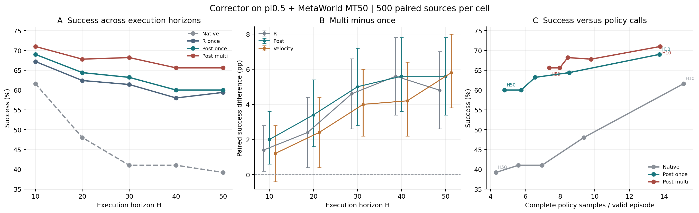

# 当前实验结果分析：整体收益明确，创新点证据强弱不均

> 主线版本更新（2026-09-22）：用户已根据本轮结果选择不限总触发次数的 G0-multi 为主线。本文以下保留当时分析及 once 建议作为历史记录；当前主线、已完成结果和待验证清单以[数据总表](EXPERIMENT_RESULTS_MASTER.md)及[多次干预验证安排](../sim_command/20260919/deadline_20260924/MULTI_PRIMARY_VALIDATION_PLAN_V1.md)为准。SmolVLA/X-VLA 的专属辅助网络现均已完成32000次更新，正在接续原 once 评测；本文较早的采集状态不代表当前状态。

证据截止：2026-09-22 13:40 UTC附近。以下为已保存终局结果分析；Smol/X专属数据链只报采集中，不预记训练与测试。原主表20格10000有效，加新增触发30格15000有效，现为**50格25000个有效episode、共用500个初态**，不是25000个独立初态。新30格原始attempt15025，A16/B9历史技术中断已保留，最终未解决0；不是历史技术失败0。

主判断：选择性重规划明显改善长执行间隔表现；相对随机触发的结果很强；多次干预在较大H有额外收益。Post是当前更有说服力的纠偏分支，但纠偏相对仅重规划的增量仍小。E1和E6不能为所有创新点提供正面结论。专属跨底座适配与完整LIBERO证据尚待补齐。

图B为各执行端已发布的pointwise95%区间，未把区间伪装成多重校正区间。图C只统计完整策略采样次数，500有效episode包含任务失败；历史技术重试开销另保留，不代表总模型计算或墙钟速度。跨节点计时不作严格速度比较。

## 1. 主结果：大部分收益来自及时重规划

以下均为百分比，每格n=500。R是收益触发后仅重规划。

| H | N | R once | Post once | Velocity once | R multi | Post multi | Velocity multi |
|---:|---:|---:|---:|---:|---:|---:|---:|
| 10 | 61.6 | 67.2 | 69.0 | 68.0 | 68.6 | 71.0 | 69.2 |
| 20 | 48.0 | 62.4 | 64.4 | 63.2 | 64.8 | 67.8 | 65.6 |
| 30 | 41.0 | 61.4 | 63.2 | 61.8 | 66.0 | 68.2 | 65.8 |
| 40 | 41.0 | 58.0 | 60.0 | 59.0 | 63.6 | 65.6 | 63.2 |
| 50 | 39.2 | 59.4 | 60.0 | 59.2 | 64.2 | 65.6 | 65.0 |

一次干预时，Post相对N提高7.4–22.2pp，Velocity提高6.4–20.8pp。H10到H50，N由61.6降至39.2（−22.4pp），Post由69.0降至60.0（−9pp）。支持“干预缓解长chunk执行退化”。但R自身由67.2降至59.4（−7.8pp），不能把缓解全部归功于纠偏。

关键对照是Full−R：once下Post只多0.6–2.0pp，Velocity为−0.2–1.0pp。以点差做算术比较，R−N占Post−N约76%–97%；这不是因果贡献分解。10项Full−R精确McNemar p均≥.0525。H20/H40 Post的bootstrap区间不含0，但相应精确p=.0525/.0755，不应挑对自己有利的统计方法宣称显著。

multi下Post−R为+2.4/+3.0/+2.2/+2.0/+1.4pp；Velocity−R为+0.6/+0.8/−0.2/−0.4/+0.8pp。新增结果仍未改变“Post增量较一致，Velocity未稳定超过仅重规划”的判断。这些跨分支差值为描述性配对，不新增未冻结的显著性主张。

## 2. 触发机制：相对当前随机策略优势明确，但不是最优时机证明

| H | N | 随机R | 随机Post | 随机Velocity |
|---:|---:|---:|---:|---:|
| 10 | 61.6 | 61.4 | 62.2 | 61.6 |
| 20 | 48.0 | 48.4 | 49.6 | 49.0 |
| 30 | 41.0 | 42.0 | 42.0 | 41.8 |
| 40 | 41.0 | 42.2 | 41.6 | 41.6 |
| 50 | 39.2 | 39.2 | 39.2 | 39.0 |

随机干预结果大多接近原N；相同分支的G0-once比Random-once高5.8–21.2pp。按预先冻结的15比较族做双侧精确McNemar与Holm校正，15项均通过.05。这是本轮新增最清晰的正面证据：不能在任意预定随机时刻插入操作就期待同样收益。

但它比较的是两套完整可执行触发策略，不是相同实际次数下的纯时机效应。H10随机只有250/500真正触发，G0为391/500；五H随机触发率为50/61.8/68.2/67.4/69%，G0 once为78.2/81.4/83/83/81.6%。提前终止不强制触发、仍保留全500分母是正确处理。且每个H的G0有331/500在首个合法cut5触发，约占全部实际触发的80%–85%；因此收益可能同时包含较早介入的作用，未隔离出复杂收益估计相对简单早期策略的净价值。不能写“证明G0找到了最优时机”。

本补充实验是在原主表揭晓后提出，随机表和新模式在运行前固定；复用已揭晓500源，不称新的盲测或原先预注册验证。

## 3. 多次干预：长H值得，短H提升较小

Post multi相对once依H为+2.0/+3.4/+5.0/+5.6/+5.6pp；Velocity为+1.2/+2.4/+4.0/+4.2/+5.8pp；R为+1.4/+2.4/+4.6/+5.6/+4.8pp。15项multi比较经独立Holm族校正后10项通过：H30/40/50的三个分支，以及Post H20；H10三项与H20的R/Velocity未通过，不可把pointwise区间当校正显著性。

这与旧disassemble20源pilot的零差值并不矛盾：旧测试只有一个任务、20个已揭晓初态；本轮覆盖MT50、500源，原pilot不能证明多次干预普遍无效。多次收益也不只来自重复纠偏，R multi已有明显提高。

代价真实存在。Post平均干预由once的约0.78–0.83增加到1.91–2.61，46.6%–56.4%的episode干预至少两次。H50 Post每episode策略调用4.802→7.384（+53.8%），成功摊销调用8.003→11.256（+40.6%），换取5.6pp成功率；H10调用13.732→13.780，净增加仅0.35%，但还增加D/G0/Q与动作梯度。不能把multi写成免费提升。

论文建议保留已冻结once主表，新增multi作为预算—成功率扩展。不要因新测试最高值改变原主表默认设置，或宣称各H都必须multi。

## 4. 调用成本与Post选择

H10 once中，N/R/Post/Velocity每episode策略调用15.130/14.156/13.732/14.794；全部调用除成功数24.562/21.065/19.901/21.756。Post成功摊销策略调用相对N少约19%，且干预入口约.246秒，Velocity约.490秒。结合Post的较高成功率点估计，支持其作为较实用的分支，但不是Post统计上普遍优于Velocity。

跨H还存在值得展示的效果—调用数权衡：H50 Post multi=65.6%，策略调用7.384/episode；H10 N=61.6%，15.130/episode，调用点估计少51.2%。全部调用/成功数11.256与24.562，少54.2%。这是描述性跨配置比较，额外D/G0/Q与观测编码开销必须计入，不能把“策略调用减少”改写成“端到端快一倍”。原H10 Post保存的episode墙钟甚至高于N，计时scope/设备状态差异也保留。

π0.5主设置新增D/G0/Q合计11,912,530参数，其中Q四成员仅28,232；应报告完整辅助系统，不能只宣传Q。Smol/X仍用外部π0.5编码器时另计该大编码器，不把其隐藏在11.9M以外。

## 5. 尚未支持的创新点

- **完整损失组合优于消融：未支持。** E1 Post的L00/L10/L01/L11均值69.33/71.33/70.67/68.67%，Velocity62.67/66.00/63.33/65.33%。L10点估计最高，L11并非最佳；三fit-seed共用50源，不能当150个独立初态，也不能测试后改选L10冒充预定主方法。
- **收益触发优于异常触发：未支持。** E6 G0→R26/50=52%，D5→R30/50=60%，D5救回5/损害1，p=.21875。样本不足以确定D5更强，亦不能声称G0更好或两者等效。随机对照的强结果不覆盖这项反例。
- **Velocity相比Post或R更强：未支持。** once和multi都没有稳定优势；相对N的提升不能独立归因于flow内部梯度纠偏。

这几个问题应如实呈现；不是增加表格数量就能修补。论文核心最好落在“执行期间选择性更新计划改善长chunk性能，受约束Post纠偏提供较小额外收益”，而不是宣称三个组件分别全面最优。

## 6. 外部比较与适用性

同π0.5/MT50/H10，Post69%、Velocity68%、VLA-Corrector63.8%、GAF-v1 adapted63%。Post−VLA-C为+5.2pp，现有配对CI[1.8,8.2]；相关四比较Holm p=.0447。Post−GAF+6pp、Velocity−GAF+5pp，对应GAF四比较族Holm=.0115/.0432。外部对比对Post较完整，但训练数据/覆盖并未统一，GAF是适配版；VLA-C的8条日志恢复终局及缺失成本继续保留，不称官方严格同数据排名。

旧Smol/X只能说明frozen-head transfer：Smol N47.18%、Post48%、V49.4%；X N80.6%、Post81.4%、V80.6%。B的Smol、C的X专属采集现已真实8worker运行，后续训练和新评测尚无终局。合理期待专属辅助训练降低策略分布失配，但目前不能承诺提升或提前填表。

LIBERO算子版N387/399约96.99%，Post/V各387/400约96.75%，未体现优势；该版本无D/G0。Full因开发G0标签全零而终止，训练/测试0。因此尚不能声称完整方法已经验证跨环境收益。

## 7. 当前论文表述与后续优先级

1. 正文清楚展示N、R、Post、Velocity，先报告各自对N与对R的差，避免把重规划收益全归于纠偏。
2. 新随机/多次对照可成为关键机制表：强调既定触发策略价值、较大H的多次收益及额外调用；承认实际触发率与早期介入差异。
3. Post更适合作为工程推荐，Velocity保留为独立技术分支和真实结果，不包装成必然更优。
4. 继续B/C已授权专属采集—训练—评测，不因本分析新增实验、选测试最佳超参或恢复大采集。完整LIBERO仍明确缺口。
5. 现有整体性能证据已足够形成清晰结果节；若论文坚持每个创新均有显著独立收益，当前证据仍不足，尤其损失组合与Velocity纠偏增量。

## 来源与统计口径

- [持续更新结果总表](EXPERIMENT_RESULTS_MASTER.md)。
- [原20格论文汇总r03](../sim_command/20260919/results/A/A_D24_PAPER_RESULTS_ASSEMBLY_V1/revisions/r03/PUBLICATION.json)。
- [新触发成功率表](../sim_command/20260919/deadline_20260924/analysis_20260922_current/trigger/TRIGGER_SUCCESS_TABLE.csv)。
- [30项配对检验与两个独立Holm族](../sim_command/20260919/deadline_20260924/analysis_20260922_current/trigger/PAIRED_TIMING_MULTIPLICITY_WITH_HOLM.csv)。
- [调用与干预成本](../sim_command/20260919/deadline_20260924/analysis_20260922_current/trigger/TRIGGER_CELLS_AND_COSTS.csv)。
- [各分支相对R的描述性配对](../sim_command/20260919/deadline_20260924/analysis_20260922_current/trigger/FULL_MINUS_R_PAIRED_DESCRIPTIVE.csv)。

本次仅读取保存终局、计算CPU配对计数/精确McNemar及Holm、转录既有bootstrap区间并作图，无模型/环境/训练调用。95%区间条件于固定50任务/500源和既有训练模型；不覆盖新训练seed不确定性，不把不同H当独立初态扩大样本量。所有新增技术故障、修正与费用缺失原样保留。
