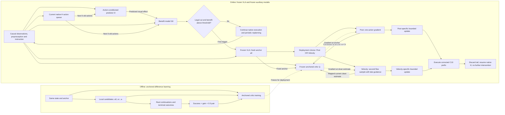

# Corrector：ICLR idea 与论文方法图说明

整理日期：2026-09-20。用途：把论文定位、当前方法、绘图结构、英文标签和图注集中到一份材料中，可直接交给绘图者或用于生成初稿。

本文整理当前 Post / Velocity 论文方案，保留已实现算法与待验证主张的区别。项目暂称 Corrector，正式论文名称尚未确定；**VLA-Corrector 是他人的参考基线，不是本方法名称。** 本文不改变算法、实验计划或任何运行授权。

下文生成50步、修复10步、每5步监测、总预算300步及具体动作公式，均指当前 **π0.5＋MetaWorld** 实例；其他底座和LIBERO的动作协议需各自适配，不由这张图自动确定。

## 1. 论文要讲什么

**一句话：**在冻结的动作分块式 VLA 上，先根据预测的重规划收益决定是否提前中断旧计划，再用锚定差值监督学到的 critic，通过 Post 或 Velocity 分支对新计划进行受约束的局部修复。

可以用于图上方的工作标题：

> **Benefit-triggered action correction for frozen VLAs**

动机是两个不同的问题：**什么时候值得换计划，以及换出的计划还能怎样改善。** 普通重规划本身就可能带来收益，因此论文要将重规划收益与进一步纠偏的收益分开检验。Q 分数上升不等于真实任务一定改善。

### 三个主要创新点及对应图示

| 拟提出的贡献 | 方法内容 | 图中应突出什么 | 对应实验 |
|---|---|---|---|
| ① 根据收益决定何时干预 | D 预测旧动作的视觉效应，G0 估计换计划相对继续旧计划的终局收益 | `Predicted replanning benefit` 判断门；继续旧队列和提前中断两条路径 | E6 收益触发 vs 异常触发，统一接普通重规划 R；E4 完整系统 |
| ② 面向动作改进的锚定差值监督 | 固定新计划 a0 为锚点，联合学习成功概率、相对锚点收益、正反候选差 | 锚点 b、候选 a、三项监督及同一 critic | E1 同数据同网络的 L00/L10/L01/L11 |
| ③ 两种独立的受约束纠偏 | Post 在采样后修复；Velocity 在第二次采样末段引导；最终各自限制修改范围 | 两个替代部署分支、动作梯度、各自半径、只执行修复前缀 | E4 的 P−R、V−R 与 H 曲线；E8 适用性 |

局部配对数据采集是训练手段，不单列创新。冻结 VLA、单步动作梯度、flow 引导分别已有先例；第三项强调它们如何构成当前纠偏方法，不宣称这些操作本身首创。小型 critic 是模型属性，不能替代方法有效性证据。

## 2. 推荐主图：离线学习一栏，在线执行一栏

建议横向双栏宽图：**上方约三分之一为离线 Q 学习，下方约三分之二为在线执行。** 用 ①②③ 编号对应三项贡献，但不强迫图的空间顺序等于贡献编号。

### 上栏：② Offline anchored-difference learning

从左到右画：

1. **同一干预状态与新锚点**：状态历史 s、新计划 a0、有界前缀 b。
2. **局部候选与真实结局**：a0、a+、a−，在可比较的状态下执行并续跑，获得终局标签。
3. **三项监督**：success / gain / pair，汇入锚定 critic Q。
4. 从训练好的 Q 向下画虚线，标 `Freeze for deployment`，连接在线纠偏中的 Q。

训练区中，从真实仿真续跑指向监督目标的箭头标 `Terminal outcomes`。不要把结局、真实未来观测或完整物理状态画成在线模型的输入。

主图可用 a0/a+/a− 解释监督结构，**不必写候选数量、重复次数或数据集规模**。若画具体数据配置，必须标清版本：历史 A4000 使用既有 13 候选×4 后缀的混合库；新 MT50 共同池方案是 Q 的 a0/局部±各2后缀，仍处于采集器 CPU 实现阶段。不能用新配置描述旧权重的训练经历。

### 下栏左侧：① Benefit-triggered intervention

输入画三种图标：相机观测、机器人本体信息、语言指令。旁边画一条**正在执行的旧动作队列**，已执行部分与剩余部分颜色不同。

- 因果历史与旧队列接下来5步动作 → D → 预测视觉效应。
- 因果历史、旧5步动作和 D 的预测效应 → G0 → 预计重规划收益。
- 判断门：`Benefit > threshold`，同时满足合法干预条件。
- 未触发：继续旧队列；队列自然耗尽时照常调用 VLA 重新规划。
- 触发：丢弃旧队列剩余部分，根据当前观测调用冻结 VLA，生成新 a0。

G0 的判断发生在生成新 a0 **之前**。不要为了画成顺直流水线，把新候选先送给 G0。D 的预测误差可以用于异常触发对照，但不是当前收益触发分支的输入。

### 下栏右侧：③ Independent constrained correction

绘制一个大框，标题 `Choose one branch before deployment`。框内上下放 Post 和 Velocity 两个小流程，表示两种独立部署方案。

| Post 小流程 | Velocity 小流程 |
|---|---|
| 完整无引导采样得到 a0 | 完整无引导采样得到锚点 a0 |
| Q 在固定锚点处给出一次动作梯度 | 用相同初始噪声进行第二次 flow 采样 |
| 经过动作坐标缩放形成方向 | 在最后3个 flow 步骤中用 Q 梯度修改速度 |
| 根据 Post 自身方向计算约束半径 | 从最终引导计划与锚点之差得到方向，并计算自身约束半径 |
| 输出修复后的前10步 | 输出修复后的前10步 |
| **1 full VLA sample** | **2 full VLA samples** |

为节省版面，框外可以只画一次“生成 a0”，然后分出两种方案；此时必须注明 a0 是**各部署方案内部生成的锚点**，并保留 Post=1 / Velocity=2 的总采样标注。不能将此画法解释为两方法共享生成成本。

两分支的约束框可以具有相同外观，但分别标 `Branch-specific radius`；不能通过另一分支的方向或半径互相连接。主图不必加入历史 direct 分支。

输出动作条中，前10格为修复/执行区，后40格为未执行区。到达 C10 后丢弃尾部及隐藏队列，恢复正常 native H 规划；成功或真实终止可提前结束。当前每个 episode 最多一次干预，因此修复后的路径**不返回 G0 判断门**。

## 3. 供绘图使用的逻辑草图

此 Mermaid 只定义模块和依赖关系，最终排版建议按第2节做上下两栏。Q 到分支的虚线表示动作梯度，不是给 VLA 参数更新权重。

逻辑图中的 `SELECT` 是**部署配置**，不是按当前 Q 分数挑赢家的在线决策器。最终成图更适合用一个“二选一方案”括号，避免读者误以为增加了一层动态选择网络。分支送入Q的是当前待求导的候选：Post在a=b处计算，Velocity在映射后的当前clean估计处计算；Q返回动作梯度，不向VLA权重反传。

## 4. 图中符号和必要公式

### 4.1 符号与时间尺度

| 符号 | 含义 | 建议图示 |
|---|---|---|
| s | 因果历史、任务信息和剩余预算等上下文；不含真实未来 | 历史观测小卡片 |
| q_old | 正在执行的旧计划队列 | 一条部分已执行的动作条 |
| a0_raw | 触发后新生成的50步原始动作计划 | 新的50格动作条 |
| b | clip(a0_raw[:10], −1, 1)，固定评分锚点 | 固定锚点标记 |
| a | Q 评分使用的有界10步候选动作 | 小幅偏离锚点的动作条 |
| H | 正常执行长度；主结果计划扫描10/20/30/40/50 | `Native horizon H` |
| C=10 | 干预后执行的修复前缀长度 | 前10格高亮 |
| 5 | 监测间隔及 D/G0 使用的旧动作长度 | `Monitor every 5 steps` |
| 300 | 从原 episode 初始开始的控制步预算 | 可留在图注，无须占主图 |

H 与 C 是不同量。H>10 时修复仍承诺 C10，完成后恢复原 H，不能全部画成“以后永远 native10”。图中动作幅度是命令空间量，不能标成未经定义的米或毫米。

### 4.2 G0：预计重规划收益

主图写 `Predicted replanning benefit` 即可。当前数值门为两成员 G0 平均值严格大于0.05，同时满足合法cut条件；G0是实数回归输出，没有sigmoid。

其标签比较的是“fresh先执行5步再native10续跑”与“old先执行5步再native10续跑”的终局成功率。新共同池保留3份fresh各2后缀与old2后缀。该标签协议与在线修复C10、不同native H不完全相同，因此图注不能称G0是所有H下精确校准的修复收益或最优干预时机。

### 4.3 Q：锚定结构与三项监督

适合放在训练区的简式：

$$
z(s,a;b)=H_{\rm base}(c)+F(c,E_\delta(a-b))-F(c,E_\delta(0)),
\qquad Q(s,a;b)=\sigma(z).
$$

其中 c 编码状态与锚点；简式省略固定的动作差尺度。写作时使用下标 `base`，避免基线头与正常horizon H混淆。在 a=b 时优势项相消。

$$
\mathcal L=\mathcal L_{\rm success}+\mathcal L_{\rm gain}+0.5\mathcal L_{\rm pair}.
$$

三项分别学习：候选经验成功率、候选相对a0的成功率差、a+相对a−的成功率差。success使用BCE；两种差值使用平方误差。均在源内按有效去重候选/配对平均，再对源平均。缺失结局不填0，空gain/pair项为0而源保留。

Q只读已观测上下文、固定锚点和候选动作，**不显式读取D预测未来**。当前选定A4000路径冻结状态/锚点编码与基线头，更新动作差和优势模块；新MT50训练初始化尚待相应训练合同冻结。因此训练区宜写 `Train anchored critic`，不要标“全部Q模块从零训练”。

在线评分目标为四成员概率差的平均：

$$
\mathcal J_s(a;b)=\frac14\sum_{m=1}^4[Q_m(s,a;b)-Q_m(s,b;b)].
$$

锚点槽固定，因此减去锚点分数不改变候选动作梯度；创新定位在训练监督及锚定输入，而不是“减基线产生新梯度”。

### 4.4 Post 与 Velocity

**Post：**一次完整采样后，在命令坐标中取

$$
g_a=\left.\nabla_a\mathcal J_s(a;b)\right|_{a=b},\qquad d_P=S^2\odot g_a.
$$

S来自内部动作坐标到命令坐标的反归一化缩放。随后由自身约束算出实际增量；不是固定学习率多步优化，也不使用Velocity的α。

**Velocity：**第二次采样与锚点采样使用相同初始噪声；在τ∈{0.3,0.2,0.1}，固定速度网络输出的数值副本，计算

$$
u=\operatorname{stopgrad}(x_\tau)-\tau\operatorname{stopgrad}(v_\theta),\quad
g_u=\nabla_u\mathcal J_s(T(u)_{:10};b),\quad
\widetilde v=\operatorname{stopgrad}(v_\theta)-\alpha\tau g_u,\quad\alpha=10.
$$

T为反归一化后clip的评分变换。Euler更新为 x_(τ−0.1)=x_τ−0.1·ṽ；这里不计算VLA速度网络Jacobian，也不跨flow步骤反传。对Q输入动作可求导，但VLA、Q及D/G0的权重在部署时均冻结。

第二次采样完成后，方向为 d_V=clip(aV_raw[:10],−1,1)−b，再进入Velocity自身约束。最终约束不保证中间clean估计或每步Q值单调改善；图中不要画“每一步都上升”的价值曲线。

### 4.5 最终约束：两分支分别计算

主图用 `Branch-specific bounded update`，小字列 `mask · group limits · raw preservation` 即可。完整规则：

- 只允许修改锚点距边界至少0.05的坐标。
- XYZ/夹爪分组RMS目标为0.05/0.10，单坐标扰动上限为0.15/0.40。
- 用本分支的masked方向归一化，结合对称边界余量得到自身可行半径；不读取另一分支，不要求两者最终同幅。
- 将增量写回原始raw计划；零增量、mask外及尾40步保持原始位模式。
- 不增加Q接受门、不回溯、不逐状态选择Post/Velocity。

若画动作空间示意图，用锚点、局部约束区域和P/V各自方向即可。两种方法可以有不同长度，不要把约束画成真实机器人安全保证，也不要把该示意区域冒充高维约束的精确几何。

## 5. 英文标签与视觉规范

| 中文 | 推荐英文 |
|---|---|
| 因果观测历史 | Causal observation history |
| 旧动作队列 | Current action queue |
| 动作条件预测器 | Action-conditioned predictor |
| 预计重规划收益 | Predicted replanning benefit |
| 保持原生执行 | Continue native execution |
| 冻结VLA | Frozen VLA |
| 新计划锚点 | Fresh anchor plan |
| 锚定critic | Anchored critic |
| 成功率/增益/正反差监督 | Success / gain / pair supervision |
| 采样后纠偏 | Post-sampling correction |
| 采样中速度引导 | Velocity guidance during sampling |
| 分支自身的受限更新 | Branch-specific bounded update |
| 部署前二选一 | Choose one branch before deployment |
| 执行修复前缀 | Execute corrected prefix |
| 恢复正常规划长度 | Resume native horizon H |

布局采用白底矢量风格，正文大小下仍可读。冻结VLA用灰蓝色与锁图标；收益触发用蓝色；Q学习/动作梯度用橙色；受限动作输出用绿色。实线表示数据/执行依赖，虚线表示训练权重交接或动作梯度，并在图例中区分。不要仅靠颜色区分分支，保留Post/Velocity文字。

主图最多保留三项loss总式、J定义和P/V各一个简式；网络层数、PCA维度、资源配额、文件名及所有超参数留给正文或附录。若标参数量，应明确“current A4000 critic ensemble：28,232 parameters”，不能把本轮更新的10,116参数写成整个系统参数，也不能将该规模自动推广到未来所有底座；主图可以完全不放参数数值。

## 6. 可直接使用的图注草稿

**中文：**

> 方法概览。离线阶段，我们以无引导计划为锚点，利用局部候选的真实终局结局，通过成功概率、相对锚点增益与正反候选差监督训练critic。在线阶段，冻结的动作条件预测器和收益模型根据因果历史与旧动作队列判断是否提前重规划。首次合法触发后，冻结VLA生成新锚点；预先选定的Post或Velocity分支分别在采样后或第二次flow采样中使用critic动作梯度。两分支独立约束最终修改，执行至多10步修复前缀；若任务未结束，丢弃尾部并恢复原生规划长度H。部署不更新模型权重，每个episode最多一次干预；图中两分支表示替代部署方案。

**English:**

> **Method overview.** Offline, an anchored critic learns from terminal outcomes of local action candidates using success, anchor-relative gain, and paired-difference supervision. Online, a frozen action-conditioned predictor and benefit model use causal history and the current action queue to decide whether to replan early. At the first eligible trigger, the frozen VLA produces a fresh anchor. A correction branch selected before deployment uses critic action gradients either after sampling (Post) or during a second flow-sampling pass (Velocity). Each branch independently bounds its final modification and executes up to ten corrected steps. If the episode continues, it discards the unused tail and resumes the native horizon H. Model weights remain frozen during deployment, with at most one intervention per episode. The two branches are alternative deployment choices.

## 7. 给绘图工具的英文指令草稿

以下用于排版初稿，不是要求生成实验结果图。数学符号可在后续矢量编辑中排版。

> Create a clean, editable academic method overview with a white background and a wide two-tier layout. The upper tier shows “Offline anchored-difference learning”: a fixed anchor plan and local positive/negative candidates, real terminal outcomes, three losses labelled “Success”, “Gain”, and “Pair”, and an anchored critic. A dashed weight-transfer arrow connects this critic to the online tier, labelled “Freeze for deployment”. The lower tier shows causal observations and a current action queue entering an action-conditioned predictor D and a replanning-benefit model G0. A benefit gate either continues native execution with periodic replanning or triggers generation of a fresh anchor by a frozen VLA. To the right, show Post and Velocity inside a bracket labelled “Choose one branch before deployment”. Post uses one full VLA sample followed by one action-gradient correction. Velocity uses two full samples in total, with guidance in the last three steps of the second sampling pass. Give each branch its own bounded-update box, then show execution of a corrected ten-step prefix and resumption of native horizon H. Use grey-blue for the frozen VLA, blue for triggering, orange for critic learning and action gradients, and green for corrected actions. Do not show a shared radius, online winner selection, a Q acceptance gate, gradients into VLA weights, privileged future inputs, or repeated intervention after correction. Do not include performance numbers or imply guaranteed improvement.

## 8. 绘图前最后核对

1. D/G0先判断，触发后才生成a0；旧队列与新锚点不是同一条计划。
2. Q输入中没有D预测未来、真实未来观测、success标签或恢复用完整物理状态。
3. Post与Velocity独立部署，各自半径；没有共同matcher、在线选优或Q接受门。
4. “模型冻结”不等于禁止对动作求梯度；但不能画梯度更新VLA权重。
5. 生成50、修复C10、正常H、监测5清楚区分；修复后不继续触发。
6. 方法图不放尚未完成的MT50主结果。已有standalone五任务结果与工程预检不代表完整MT50效果。
7. 不宣称配对采集本身创新、数据效率、更高微调效率、最优方向、安全保证或零训练跨域迁移。

## 9. 来源与版本优先级

- [当前实验计划：三项创新与主张边界](Experiment_plam.md)：论文定位与实验范围的主要依据。
- [当前算法审核文档](NATIVE10_CORRECTOR_ALGORITHM_ZH.md)：使用标注“现版本”的独立分支定义；旧共同半径仅属历史。
- [共同池协议决定V2](../sim_command/20260919/contracts/COMMON_POOL_PROTOCOL_DECISIONS_V2.md)：新数据设计、目标时域、配对资格的依据；不是已经完成采集的结果。
- [共同池V2设计验收](../sim_command/20260919/manifests/COMMON_POOL_REVISION_CPU_V2_ACCEPTANCE.json)：目前仅完成协议/报价验收。
- [独立分支实验封存报告](STANDALONE_CORRECTOR_ABLATION_20260918.md)：既有独立部署结果及证据边界。
- [旧ICLR idea背景说明](ICLR_IDEA_EXPERIMENT_BRIEF_ZH.md)：2026-09-18背景材料，保留供追溯。其中共同半径、完整bank依赖及“独立Post尚未验证”等描述不用于当前方法图。

若材料发生冲突，论文主张以当前实验计划为准，部署公式以算法“现版本”为准，新采集规则以共同池V2合同为准；历史实验结论仍按各自封存协议解释，不能用新方案改写旧结果。
