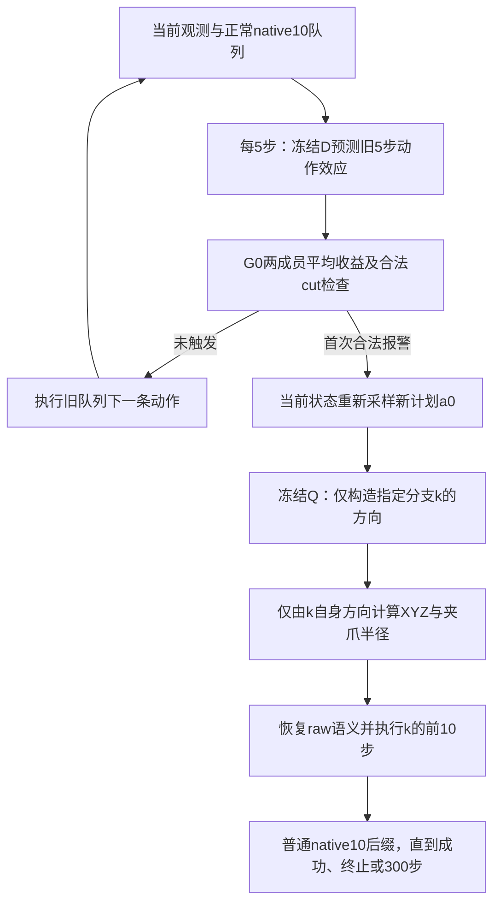

# VLA中断重规划与动作纠偏：完整算法审核文档

**版本：2026-09-19；在2026-09-17主文档上，补入2026-09-18已封存的独立分支实现。仅在发生变化处标注旧版本/现版本。**

本文描述从数据采集、网络训练到在线执行的完整流程。基础系统为 **Pi0.5 + 冻结D/G0中断触发器 + A4000四成员critic**。velocity、direct、post三种算法全部保留；前两种在flow采样途中引导，第三种在采样结束后修正。

**【旧版本】** 原held前封存的主方案为完整共同幅度匹配的 `matched-post`，即使只执行post，也要生成其他方向来决定半径。**【现版本】** `solo_post`、`solo_direct`、`solo_velocity`分别独立生成自身候选，只由自身方向决定幅度，部署前固定其中一种。数据采集、网络训练和三种原生梯度公式未改；A4000仍来自原混合候选训练数据，不能把部署独立写成训练全流程独立。

本文只整理现有算法，不修改代码、模型、参数或实验结果。历史任务书中“尚未训练”、旧50/50评估划分等文字不代表最终状态；以下以实际训练、原held与独立分支结构消融的冻结产物为准。

## 阅读顺序

- **先看第1–3节**：系统做什么、何时中断、训练数据从哪里来。
- **第4–5节**：critic结构、监督目标及实际训练策略。
- **第6–8节**：三种纠偏的数学公式、动作坐标，以及旧共同半径与现独立半径。
- **第9–11节**：整套执行流程、选模/校准/评估，以及需要重点审核的设计选择。
- **第12节**：实现与封存证据入口。

---

## 1. 系统组成与关键时间尺度

### 1.1 四个模块各自负责什么

| 模块 | 输入与输出 | 本轮是否更新 |
|---|---|---|
| **VLA：Pi0.5** | 当前图像、本体观测、任务指令 → 一段动作 | 冻结 |
| **D：动作条件世界模型** | 因果观测历史、旧队列未来5步动作 → 未来5步特征预测 | 冻结，两成员 |
| **G0：中断收益模型** | 当前历史、旧5步动作、D预测的视觉效应 → 预计换计划收益 | 冻结，两成员 |
| **Q：动作成功率critic** | 当前历史、新计划锚点、候选10步动作 → 终局成功概率估计 | 用本轮新数据训练，最终四成员A4000 |

G0负责判断是否中断；Q负责给纠偏提供方向。**G0的0.05门限不施加到Q上。** 原held固定主策略在首次合法G0报警时统一执行post；现独立版本在部署前固定post/direct/velocity中的一种，两者都没有逐源“Q提高才接受”的第二道门。世界模型D与后文direct模式的下标D属于不同记号，按所在模块区分。

实际VLA为本机 `sft_pi05_mt50/checkpoints/030000/pretrained_model` 的 `pi05`：PaliGemma配置为 `gemma_2b`，动作expert为 `gemma_300m`。本轮没有重训VLA或大特征提取器。

### 1.2 三个长度必须区分

| 参数 | 当前值 | 含义 |
|---|---:|---|
| 生成长度 | 50 | VLA每次生成50条四维动作 |
| 正常执行horizon | 10 | 只执行该计划前10条，随后根据新观测重新规划 |
| 监测间隔 | 5 | 每5个环境控制步计算一次G0 |
| 中断后的动作承诺长度 | 10 | replan及三种纠偏各执行新的10步前缀 |
| 总控制预算 | 300 | 从episode初始时刻计数，cut后不重新计300步 |

四维动作是XYZ与夹爪控制命令。XYZ是环境命令量纲，本文不把它直接解释成米；环境控制步也不直接换算为固定毫秒。

**正常native10仍会周期性重规划。** 它表示没有报警触发的额外中断，不能写成整条episode永不重新规划。未使用的40条生成动作不会在当前10步队列耗尽后接着执行。

### 1.3 在线流程总览

**【现版本：独立部署】** 下图的k为部署前固定的post、direct或velocity，不是在报警后根据Q选择的分支。

**【旧版本：上图被替换的生成步骤】** 同一a0上构造V/D/P及反向direct、random，取共同半径，执行固定matched-post。监测、中断时刻与干预后的native10后缀未变。

图中D预测与G0判断发生在生成新a0之前。一次干预后不再调用G0或继续纠偏；当前验证的是**每episode最多一次干预**。

## 2. 中断判定：D、G0及合法cut

### 2.1 G0使用哪些信息

在环境控制时刻`t`，构造因果上下文：

- 最近至多5帧4096维视觉特征及有效性mask；不足部分补零。
- 同期5帧四维本体观测、最近4条已执行动作。
- 2048维任务语言表示及剩余预算比例`(300−t)/300`。
- 当前旧队列接下来5条尚未执行的动作。

D的两成员为`spatial_pair WorldModel`，GRU宽256，每成员4,474,116参数。它预测未来5×4096视觉特征及5×4本体观测；当前G0路径只使用预测视觉特征。

G0的两成员为`BenefitModel`，每成员1,468,033参数：历史经宽128的GRU编码；旧5×4动作投影到128维；D预测相对当前视觉特征的效应经过时间平均、投影到128维；再拼剩余预算1维，形成385维输入，经`385→128→1`得到实数收益。隐藏层SiLU、训练dropout为0.1，推理时关闭。当前G0不显式输入完整剩余队列，队列年龄用于外部合法性检查。

### 2.2 G0原来的训练目标

令`p̂`表示按固定后续执行规则获得的经验成功率。旧G0目标为：

$$
y_G(s)=\frac{1}{3}\sum_{j=1}^{3}\hat p(\text{fresh}_j\text{执行5步后转fixed10})
-\hat p(\text{old接下来5步后转fixed10}).
$$

也就是从同一状态比较三份fresh计划与old计划：每个候选先真正执行5步，再按普通10步策略续跑至成功、终止或总300步。标签使用完整续跑结局，不是5步内的即时奖励。

旧训练记录中，50个计划训练源有40源提供80个cut级标签，对应4候选×2后缀的640个二值结局；验证20源提供39个cut、312个结局。G0使用`SmoothL1(beta=0.1)`，AdamW学习率1e−4、weight decay 1e−3、batch为16个cut组，最多1600更新，按验证MAE选检查点。实际两个成员选择step1000和1200。

**G0输出是收益回归值，不经过sigmoid。** 当前报警数值条件为两成员平均输出严格大于0.05。按旧目标单位可解释为预计换计划增益超过5个百分点；它不是失败概率或安全概率。

这里有一个需要审核的协议差异：旧G0源轨迹的规划horizon混有20/50，标签承诺5步；本轮正常执行是native10，主动干预承诺10步。G0与D本轮保持冻结，所以不能直接把其输出当成当前normal与replan差值的已校准估计。当前实现也没有用D预测误差超过阈值来报警。

### 2.3 合法报警时刻

每一步先处理自然队列耗尽、必要时重新规划，再做5步一次的监测。有效中断必须同时满足：

1. 尚未成功或终止，且位于监测点。
2. 当前计划已经执行过至少一步，`plan_age>0`。
3. 旧队列尚有至少5条动作供D/G0判断。
4. 总预算还允许执行新的10步前缀。
5. 当前episode尚未发生过干预，且G0超过0.05。

native10下合法cut为5、15、25……285。0、10、20……属于自然规划边界，新队列年龄为0，不额外中断；295可监测但只剩5步，不能干预。**最后有效cut是285。**

## 3. 新训练数据如何采集

### 3.1 划分与用途

五任务为disassemble、pick-place-wall、shelf-place、stick-pull、stick-push，均为MetaWorld v3任务。

| 集合 | 独立episode | 每任务 | 候选/后缀 | 用途 |
|---|---:|---:|---|---|
| 第一轮train | 300 | 60 | 13候选×4，另normal×4 | 原冻结critic生成候选，训练首轮A/B |
| 第二轮train | 300 | 60 | 同上 | B200生成新局部候选，扩展训练数据 |
| development | 100 | 20 | 固定13候选库×4；另规定的五臂真实测评 | 两轮选critic、最终选主方法 |
| calibration | 100 | 20 | 五臂×2 | 固定critic/post后选择统一启用开关 |
| heldout | 100 | 20 | 五臂×4 | 最终独立测试 |

主episode共900个；另20个P0技术诊断episode不计入这900个。全部600训练源实际有有效cut，形成 **31,200个候选二值标签＋2,400个normal控制标签**。源内标签相关，不能视为31,200个独立状态。

每个episode初始化后、第一次动作前检查物理场景身份。只允许初始化失败或场景重复时使用原有序备用；无报警、早成功、低Q或候选效果差均不触发换源。场景指纹和完整MuJoCo状态用于恢复/去重审计，不进入Q；规定的本体观测仍是模型输入。

### 3.2 训练切点：50%首次报警请求、50%预登记时刻

每轮300源预先分为150个first_alarm请求源，以及scheduled15/45/95各50源；每任务30个报警请求，三个scheduled时刻各10个。请求报警的源也可能实际使用无报警fallback，因此请求配额不等于实际报警源数。

| 请求类型 | 实际选择规则 |
|---|---|
| first_alarm | 首次合法报警；整条正常轨迹无报警时，按15→5使用已到达合法anchor |
| scheduled15 | 15不可达时回退5 |
| scheduled45 | 按45→15→5顺序 |
| scheduled95 | 按95→45→15→5顺序 |

回退只看已到达、非终止、剩余预算足够的状态，不能依据候选结局或Q选择。scheduled轨迹不会因为目标前G0报警就改成报警cut。每源只选一个主要cut。

dev/cal/held仅使用首次合法报警，**没有scheduled或训练fallback**。若全程无报警，保留正常执行的真实共同结局与完整分母。

### 3.3 两轮数据的teacher边界

两轮源轨迹都由冻结VLA按正常native10执行，D/G0负责监测。第一轮使用旧四成员critic生成局部候选；首轮训练选择B200后，第二轮使用B200生成候选。

**B200只改变cut处的候选生成器；第二轮源轨迹不会执行B200纠偏。** 标签仍来自真实环境续跑，不以teacher Q作为蒸馏标签。两轮合并的是同定义的原始观测特征，并保留各自采集协议与teacher身份。

### 3.4 每个cut的13候选

`a0`统一指在cut重新生成的新计划，旧队列另行保存。这里记录的是已完成的训练数据采集，仍先按第7节原生方向及第8节**旧版本共同匹配**构造matched V/D/P，再扩展训练候选；本次独立部署消融没有重新采集训练标签或重训：

| 槽 | 候选 | 对新a0的改动 |
|---:|---|---|
| 0 | a0 | 无改动，相对收益锚点 |
| 1/2 | XYZ正/负 | ±λ倍已实现post的XYZ扰动，夹爪不动 |
| 3/4 | 夹爪正/负 | ±λ倍已实现post的夹爪扰动，XYZ不动 |
| 5/6 | 随机半幅正/负 | ±0.5倍独立平滑随机可行扰动 |
| 7/8 | 随机全幅正/负 | 同一随机方向的全幅正/负 |
| 9 | velocity | 正式matched velocity |
| 10 | direct | 正式matched direct |
| 11 | post | 正式matched post |
| 12 | reverse_post | 已实现post扰动取反 |

λ在采集前按源登记为0.5或1，每轮300训练源各150个。它只缩放XYZ/夹爪探针，**不改变正式V/D/P的0.05/0.10共同RMS目标**。若post某通道为零，该通道探针使用独立平滑随机fallback并记录标记。

随机方向为每动作维3个高斯时间节点，位于0、4.5、9，再对10步线性插值。独立随机探针按自己的对称可行约束投影。13候选不会再一起取共同最小半径；槽9/10/11保持正式候选原样。

### 3.5 标签、分支恢复及配对

每个候选从同一cut物理状态恢复，先执行该候选前10步，再转普通fixed10后缀；总预算仍是从episode开始算300步。对源`i`、候选`j`、后缀重复`r`：

$$
y_{ijr}=\mathbf 1\{\text{在剩余执行中出现环境success}\},\qquad
\hat p_{ij}=\frac14\sum_{r=1}^{4}y_{ijr}.
$$

这是候选10步动作在固定后续策略下的长期成功监督，不是“第10步是否成功”。normal对照保留旧队列后正常续跑，其标签单独存储，不进入Q损失、不作为槽0，也不用于本轮重训G0。

实验恢复通过reset并重放cut前已记录的raw动作实现，逐步核对物理状态、奖励/终止以及cut图像；不会让VLA重新生成一遍前缀再假定状态相同。建bank本身不推进环境。

同一源只生成一份a0和候选bank，4个repeat复用它，只改变后缀随机流。后缀seed由episode/cut/repeat/后缀决策序号确定，不包含方法名。各方法第`j`次后缀采样使用相同噪声身份，但状态可以不同。

### 3.6 别名与缺失处理

别名指同源、同协议下**前10步raw命令逐字相同**，仅clip后的表示相同不算。实际主采集仍完整执行13×4及normal×4，没有用别名省掉物理分支。

训练时按distinct raw动作组去重：组内槽权重为1/组大小；与a0相同的组不进入gain项；同组正反pair不计，重复无序组对只计一次。缺少完整四个标签不能填0。每源先在内部平均，再在源间平均，不额外提高“有差异源”的采样权重。

## 4. Q网络：预测对象、结构与锚定

### 4.1 观测特征

每个成员先生成61维状态特征：

| 输入 | 处理 | 输出维度 |
|---|---|---:|
| 5×4096视觉历史与mask | 按保存的mean/std标准化、clip[−8,8]；拼最新帧与masked历史均值，8192维投影到PCA16 | 16 |
| 2048维语言 | 无参数LayerNorm后PCA8 | 8 |
| 5×4本体历史 | mask后展平 | 20 |
| 最近4×4已执行动作 | 展平 | 16 |
| 剩余预算比例 | `(300−cut)/300` | 1 |
| 合计 |  | **61** |

PCA投影按保存尺度归一化并clip[−8,8]。mask用于计算，不另作为额外输入维度。Q使用已观测历史，不显式使用D预测未来，也不读取真实未来、success标签或实验恢复用的完整物理状态。

### 4.2 每个成员的五个小MLP

| 模块 | 维度 | 参数数 |
|---|---|---:|
| 状态编码器`E_s` | 61→32→16 | 2512 |
| a0动作编码器`E_a` | 40→16→16 | 928 |
| 动作差编码器`E_δ` | 40→16→16 | 928 |
| 基线头`H` | 32→32→1 | 1089 |
| 优势头`Fadv` | 48→32→1 | 1601 |
| **合计** | 隐藏层SiLU，无Dropout/BatchNorm | **7058/成员** |

动作输入为10×4=40维。记`b`为固定a0的有界前10步，`a`为候选有界动作，`f`为该成员的61维状态特征，动作差输入尺度为`d=(0.15,0.15,0.15,0.40)`，按时间广播：

$$
c=[E_s(f),E_a(\operatorname{vec}b)],\qquad
v(a)=E_\delta\!\left(\operatorname{vec}\frac{a-b}{d}\right),
$$
$$
z(f,a;b)=H(c)+F_{adv}([c,v(a)])-F_{adv}([c,E_\delta(0)]),
\qquad Q(f,a;b)=\operatorname{sigmoid}(z).
$$

因此`a=b`时优势项相消，数学上基线logit为`H(c)`。此Q的含义是：**给定状态、固定a0锚点，执行候选10步再按既定后缀策略续跑的成功概率估计**。它不是通过Bellman备份得到的通用最优Q函数。

模型中的相对输入尺度`d`与第8节的最终RMS目标是两种参数，不应混用。

## 5. 训练策略、损失与最终A4000

### 5.1 三项源级损失

令`G_i`为源`i`的distinct候选组，`G_i^+`排除a0组；`P_i`为去重后的有效正反组对：`(1,2)、(3,4)、(5,6)、(7,8)、(11,12)`。记`p_ij=Q(f_i,a_ij;b_i)`，监督均值为`p̂_ij`：

$$
L_{success,i}=\frac1{|G_i|}\sum_{j\in G_i}
\operatorname{BCEWithLogits}(z_{ij},\hat p_{ij}),
$$
$$
L_{gain,i}=\frac1{|G_i^+|}\sum_{j\in G_i^+}
\big[(p_{ij}-p_{i0})-(\hat p_{ij}-\hat p_{i0})\big]^2,
$$
$$
L_{pair,i}=\frac1{|P_i|}\sum_{(j,k)\in P_i}
\big[(p_{ij}-p_{ik})-(\hat p_{ij}-\hat p_{ik})\big]^2,
$$
$$
L=\operatorname{mean}_{i\in batch}
\left[L_{success,i}+L_{gain,i}+0.5L_{pair,i}\right].
$$

空gain/pair集合对应项为0，该源仍保留在外层平均中。正反项监督有限候选的成功率差，不是真实动作梯度标签；不除以半径，不使用TD损失、排序hinge或额外跨半径损失。

### 5.2 两条训练路径都实际完成

| 项目 | A：旧critic残差适配 | B：全小critic重训 |
|---|---|---|
| 初始化 | 原旧四成员权重 | 四个新初始化MLP |
| 可训练 | `E_δ`与`Fadv`，2529参数/成员 | 全部7058参数/成员 |
| 冻结 | `E_s/E_a/H`及全部预处理buffer/PCA | 拟合完成后的预处理buffer/PCA |
| 投影 | 原成员各自旧PCA | 当前阶段唯一训练源拟合PCA16/8，四成员共享 |
| 学习率 | 1e−4 | 3e−4 |
| 第一轮更新 | 每成员2400 | 每成员2400 |
| 最终更新 | 每成员4000 | 每成员4000 |

最终A重新从原旧成员开始，最终B在合并600源上重新拟PCA并fresh初始化；二者都不接着首轮A或B200继续训练。真实fit使用已封存预检初态与投影，避免重复拟PCA或换初始化。

A数学上没有调整a0基线头的自由度，只学习相对修正；这不等于宣称不同检查点的绝对a0概率在float32中逐位不变。同一模型、同一a0的相对收益锚定为0。

B的PCA在bootstrap前对每个有效训练源使用一次，开发/校准/held不参与；SVD取视觉16轴、语言8轴，投影标准差下限1e−3。最终语言8轴中4轴触及下限，不能当成8个独立有效语义方向。

### 5.3 Ensemble、采样与优化

每路径4个成员分别按任务进行episode级有放回bootstrap。最终每任务120个有效训练源，各抽120次，总600条索引；同源全部候选和后缀整体同行。每次更新从本成员清单均匀有放回抽32个完整source。

优化器AdamW，weight decay 0.01，gradient clip norm 1，固定学习率，CPU float32/2线程。检查点为200/400/800/1600/2400/3200/4000，首轮只到2400。实际完成：

- 首轮：2路径×4成员×2400＝19,200次更新。
- 最终：2路径×4成员×4000＝32,000次更新。
- 合计51,200次优化更新；这些不是episode数或epoch数。

没有按成功、Q大小、来自哪一轮或“标签有差异”额外加权。

### 5.4 选择模型，再选择部署方法

每个相同步数的4成员构成一个ensemble，不跨成员挑选不同步数。对固定开发候选库，用平均概率选候选；精确并列优先a0，然后按槽顺序。

critic检查点按以下预登记顺序选择：

1. 完整100开发源上，被选候选的真实配对净增益最大。
2. 并列时损害数更少。
3. 再比较相对a0的gain MSE，更小优先。
4. 再取较早step，最终仍并列则优先B。

5个开发无cut源保持共同结局与100源净收益分母，不伪造Q输入；gain MSE在95个有效cut源的去重非a0候选上计算，空gain源的该项为0。离线选择使用四成员概率的float64平均，在线目标为float32并另做部署重载核验。

首轮选出B200，用于第二轮候选生成；最终选出A4000。最终候选库代理增益为+4.5pp、救23害5。这个代理只比较旧候选库中的离散动作；随后必须用所选critic**重新生成并实际执行**五臂，才能评价连续梯度方法。

最终A4000开发五臂实测后固定post为主方法。随后calibration只决定全局启用：完整100源的`mean(post−replan)>0`则启用post，否则退回仅重规划。实际cal为+7pp，选择统一启用。此开关在held前封存，held不再选模型、方法或Q阈值。

## 6. 纠偏共同定义：坐标、锚点与目标

### 6.1 三种动作坐标

- **内部flow状态**：`x_τ∈R^(50×32)`，只取前4维作为动作；纠偏目标只读前10步×4维。
- **raw环境命令**：新计划`a0_raw∈R^(50×4)`，经过原后处理器反归一化，允许超出[−1,1]。
- **critic表示**：`C(a)=clip(a,−1,1)`，固定锚点`b=C(a0_raw[:10])`。

旧队列是报警前正在执行的计划，新a0是报警后基于当前观测重新采样的计划；二者在文档和实现中必须分开。

对每动作维，令`S=(q99−q01)/2`、`μ=(q99+q01)/2`，则正常非退化反归一化及评分变换为：

$$
U(u)_{t,j}=\mu_j+S_j u_{t,j},\quad j=1,2,3,4;\qquad T(u)=C(U(u)).
$$

这里U/T只取内部张量前4个动作维度，输出50×4命令；后28维不进入评分。若分位数差为0，ActionTransform用eps处理退化差值，而post显式使用原始`S²`，该维post方向为0。

### 6.2 四成员平均相对收益

冻结当前观测、锚点b和四个critic参数，定义：

$$
\mathcal J_s(a;b)=\frac14\sum_{m=1}^{4}
\big[Q_m(s,a;b)-Q_m(s,b;b)\big].
$$

每个成员先sigmoid，再平均概率差。没有LCB/UCB、方差惩罚或不确定度加权。由于锚点固定，候选动作梯度等于平均成功概率的梯度：

$$
\nabla_a\mathcal J_s(a;b)=\nabla_a\frac14\sum_mQ_m(s,a;b).
$$

`J(b;b)=0`并不要求候选梯度为0，因为锚点槽是固定常量。梯度经过动作映射和Q，不对真实环境求导，也不通过D重新预测候选后果。

## 7. 三种原生纠偏方向

### 7.1 原flow采样

Pi0.5内部路径约定为`x_τ=τ ε+(1−τ)x_0`，其中`x_0`是内部归一化动作终点、`ε`是初始噪声，速度目标为`ε−x_0`。推理从噪声开始，10次网络调用的时间依次为1.0、0.9……0.1，Euler步长为−0.1：

$$
x_{\tau-0.1}=x_\tau-0.1v_\theta(x_\tau,\tau;s).
$$

最后一步落到0，不在0再调用一次网络。用当前速度构造clean估计：

$$
u=x_\tau-\tau v.
$$

`u`是当前估计，不保证等于剩余采样结束后的最终动作。

### 7.2 velocity：对速度数值副本引导

只在`τ∈{0.3,0.2,0.1}`注入，`α=10`。先固定当前`x̄=stopgrad(x_τ)`和`v̄=stopgrad(v_θ)`，令：

$$
g_u=\nabla_u\mathcal J_s(T(u)_{:10};b),\qquad u=\bar x-\tau\bar v.
$$

把速度的独立副本作为leaf变量，则链式法则给出：

$$
\nabla_{v_{leaf}}\mathcal J=-\tau g_u,
\qquad \widetilde v_V=\bar v-\alpha\tau g_u.
$$

随后用修改后的速度完成当前Euler步。这里不计算VLA速度网络的Jacobian，也不跨采样步反传。

### 7.3 direct：直接使用clean坐标梯度改速度

同样固定当前`x̄、v̄`，把`u=x̄−τv̄`的副本作为leaf求梯度，但去掉velocity模式额外的τ因子：

$$
\widetilde v_D=\bar v-\alpha g_u.
$$

direct也不包含`I−τ∂v_θ/∂x`这样的完整VLA Jacobian。两个模式都保留反归一化和真实clamp的导数，没有用直通估计绕过裁剪。

**为何减梯度仍是上升方向：**采样步长为负。在同一个局部状态下，相对原Euler步的额外位移分别为：

$$
\Delta x_V=+0.1\alpha\tau g_u,\qquad
\Delta x_D=+0.1\alpha g_u.
$$

后续两条轨迹会分叉，不能把最终direct动作简单解释为最终velocity动作除以τ。每次注入只有一次修改，无线搜索、回溯或逐步Q准入。修改速度detach后进入下一步；后续VLA前向仍会响应已改变的状态。

日志中局部`objective_after`使用“修改速度后的clean估计”计算；其变化分别对应`u+ατ²g_u`和`u+ατg_u`，与真正Euler状态位移不同，也不保证终局成功率提高。

### 7.4 post：采样完成后的方向

先完整无引导采样得到新a0，再在有界锚点b上求一次命令梯度：

$$
g_a=\left.\nabla_a\mathcal J_s(a;b)\right|_{a=b},
\qquad d_P=S^2\odot g_a.
$$

`S²`来源于坐标度量：在内部clean坐标按欧氏梯度移动，映回命令坐标得到`δa∝SSᵀg_a`；S为对角缩放时就是逐维平方。

post不重新跑flow、不做多次梯度迭代，不使用α=10，也没有额外回溯或Q接受门。它只产生一个方向；最终步长**【旧版本】由下一节共同匹配决定，【现版本】仅由post自身的可行半径决定**。

### 7.5 小结

| 模式 | 介入位置 | 原生操作 | 本轮固定参数 |
|---|---|---|---|
| velocity | flow最后三步 | `v−ατg_u` | α10，τ=.3/.2/.1 |
| direct | flow最后三步 | `v−αg_u` | 同上 |
| post | 无引导样本生成后 | `S²g_a` | 一次梯度，幅度交给matcher |

两种flow目标只读前10步前4维；局部目标的其他位置梯度为0。后续网络前向可能引起整段输出耦合变化，但最终执行器只抽取首10步纠偏方向，尾40步恢复为a0原值。

**【旧版本：技术失败处理】** 若发生指定GuidanceError，按相同seed回退无引导采样并记录技术fallback；不是按效果择优回退。

**【现版本：独立入口失败即停】** GuidanceError或其他采样/校验错误直接停止，不额外无引导重采、不自动重试。底层采样进入、返回与异常均记录实际调用数和耗时；采样前失败计0，采样中或采样后校验失败仍计已经进入的调用。该变化只涉及技术失败处理，不改变成功路径的梯度公式、采样数学或接受规则。

## 8. 从原生方向到实际执行：幅度约束与独立投影

### 8.1 候选生成依赖

**【旧版本：同一a0上联合生成五个方向】**

无引导、velocity、direct三次采样共享初始flow噪声。设引导后的有界首10步为`b_V、b_D`：

$$
d_V=b_V-b,\quad d_D=b_D-b,\quad d_P=S^2g_a,
\quad d_{rev}=-d_D,\quad d_{rnd}=\text{平滑高斯方向}.
$$

**部署matcher中的reverse是反向direct；训练槽12的reverse_post是反向post。** 两者用途与定义不同。

这里的共同匹配随机方向按每动作维独立采3个标准高斯节点，在时间0、4.5、9上对整数0至9线性插值；随机流身份预先固定，不依据结局选择。

**【现版本：各入口只生成自身方向】**

| 独立入口 | 自身a0与方向的构造 | 干预点完整VLA采样次数 |
|---|---|---:|
| `solo_post` | 自己无引导采样a0，在自身b上求一次`d_P=S²g_a` | 1 |
| `solo_direct` | 自己无引导采样a0，再用同初始噪声做direct引导，取`d_D=C(a_D[:10])−b` | 2 |
| `solo_velocity` | 自己无引导采样a0，再用同初始噪声做velocity引导，取`d_V=C(a_V[:10])−b` | 2 |

三种原生方向仍按第7节定义。每个入口均自己生成a0；不调用另外两种纠偏、reverse或random，不读取它们的候选/半径缓存，也不先生成旧完整bank再隐藏其他臂。V/D的第二次引导采样与本入口a0使用相同初始噪声，锚点b保持固定。

研究中可以在同一恢复状态依次调用三个独立入口，但实际合计为1+2+2＝5次采样，不能共享a0后把摊销时间冒充独立部署成本。旧完整bank共享a0时为3次采样。这里“一次采样”指完整flow生成过程，内含第7.1节的10次速度网络前向。旧完整生成仅用于单列的技术复现诊断，不是独立入口的部署依赖。

### 8.2 分组归一化与可行半径

下表、mask、对称边界余量和组内归一化在两版本间不变；发生变化的是参与半径计算的方向集合与零组传播规则。

| 组g | RMS计数范围 | 目标RMS `ρ_g` | 单坐标绝对扰动上限 `L_g` |
|---|---|---:|---:|
| XYZ | 10×3，共30个数 | 0.05 | 0.15 |
| gripper | 10×1，共10个数 | 0.10 | 0.40 |

用共同锚点b定义mask和对称边界余量：

$$
M_j=\mathbf1[1-|b_j|\ge0.05],\qquad
B_j=\min(1-|b_j|,L_g).
$$

对需要的方向k计算（**旧版本**遍历五方向；**现版本**只计算所选方法自身方向）：

$$
\bar d_{k,g}=M_g\odot d_{k,g},\quad
n_{k,g}=\operatorname{RMS}(\bar d_{k,g}),\quad
e_{k,g}=\bar d_{k,g}/\max(n_{k,g},10^{-10}),
$$
$$
c_{k,g}=\min_{|e_{k,g,j}|>10^{-10}}\frac{B_j}{|e_{k,g,j}|}.
$$

RMS包含被mask清零的坐标，不能只除以活跃坐标数。容量c只在对应组范数大于1e−10时计算，零组直接进入下述零增量分支。

**【旧版本：共同半径、跨方向联动清零】** 若任一方向该组范数不大于1e−10，则该组共同半径为0；否则：

$$
r_g=(1-10^{-6})\max\left(0,\min\{\rho_g,c_{V,g},c_{D,g},c_{P,g},c_{rev,g},c_{rnd,g}\}\right),
\qquad \delta_{k,g}=r_g e_{k,g}.
$$

最终转float32并核边界、RMS、单坐标上限、五方向同幅，容差1e−6。

这套匹配有四个直接后果：

1. 实际RMS可能小于请求的0.05/0.10。
2. 任一方向的某组为零，该组所有方向一起归零；不删除源。
3. 归一化可以放大原生V/D的小改动，并非只做收缩。
4. 固定post后仍要生成V/D/reverse/random，共同半径依赖它们。**原held验证的是完整matched-post，不能用其结果代替独立post实测。**

随机与反向方向只生成保存，不额外执行为第六、第七个物理测试臂。共同约束作用于最终命令，不约束flow中间clean估计或速度。

**【现版本：自身半径、仅本方法本组清零】** 对部署前固定的方法k，若`n_{k,g}≤1e−10`，仅将该方法该组的`δ_{k,g}`置零；否则：

$$
r_{k,g}^{\mathrm{solo}}=(1-10^{-6})\max\left(0,\min\{\rho_g,c_{k,g}\}\right),
\qquad \delta_{k,g}=r_{k,g}^{\mathrm{solo}}e_{k,g}.
$$

不读取其他方法的容量或零状态；不补随机方向，也不增加零组fallback。最终转float32，沿用原边界、RMS、单坐标上限和raw一致性检查及容差1e−6，但不再要求不同方法最终同幅。归一化仍允许放大原生小方向，**不增加`min(r,n)`等“只能收缩”的规则**；实际幅度仍可能低于0.05/0.10。

在自身非零方向与mask相同的条件下，自身半径不小于旧共同半径。若旧组仅因其他方向为零而被清零，独立版本允许恢复；但本批实际没有零组恢复，夹爪9个零组均为自身mask全关。XYZ与夹爪各自放大比例可以不同，因此组内方向保持相同不等于完整40维向量方向不变。新旧比较主要检验幅度及组间权重变化，未重新学习梯度方向。

### 8.3 恢复raw锚点，避免改坏对照

matcher在有界b上计算候选，执行时复制完整`a0_raw`：只替换非零扰动坐标，零扰动、mask外及尾40步保持原始位模式。有效坐标上等价于：

$$
a_k^{raw}=a_0^{raw}+\delta_k.
$$

再次核验`C(a_k_raw)`与有界匹配候选一致，以及raw差值与C(raw)差值一致。这是评分表示与修改量的一致性，不是任意raw/clip命令的普遍物理等价证明。

例：新a0的raw夹爪为1.2时，critic看到1，mask为0，replan及三个纠偏候选在该坐标均保留raw 1.2；normal仍执行自己的旧队列。新a0的raw为0.98时因余量不足0.05也不改；raw为0.8时才允许在共同边界和幅度约束下修正。replan执行原生raw a0，不能单独给它加一次clip。

## 9. 一次完整干预如何执行

以cut=25、旧计划从20开始为例：

| 臂 | cut后的第一段 | 首次普通后缀规划 | 后续 |
|---|---|---:|---|
| normal | 保持原第25–29步，剩5条 | 30 | 普通native10 |
| replan | 新a0前10步，第25–34步 | 35 | 普通native10 |
| velocity/direct/post | 对应新前缀10步（旧共同匹配；现自身投影） | 35 | 普通native10 |

任何时候成功或环境终止即可提前结束。N与其他臂的后缀规划相位相差5步；配对seed按后缀决策序号对应，不意味着相同绝对时刻、相同状态或相同动作。

固定部署策略可概括为（现版本的方法k在部署前指定，不能按源选择赢家）：

1. 从episode初始按native10正常执行，每5步评估冻结G0。
2. 首次合法报警时保留旧队列/上下文，生成新的raw a0。
3. 冻结当前上下文与a0，构建四成员平均相对收益目标。
4. **【旧版本】** 用同噪声生成V/D，并计算post、反向D和平滑随机方向；**【现版本】** 仅生成k自身方向：post求一次动作梯度，direct/velocity各再做一次同噪声的本方法引导采样。
5. **【旧版本】** 做共同匹配；**【现版本】** 仅按自身容量投影。随后都进行相同的raw恢复及命令检查。
6. **【旧版本】** 按全局已封存选择执行matched-post前10步；**【现版本】** 执行预先固定的独立k前10步。两者都不根据此源Q重新选择。
7. 转普通native10续跑；本episode不再报警/纠偏。

正常对照在cut后使用分支后缀随机域，而非机械复用source未来的原随机域；它仍是相同native10策略的随机延续。R−N测到的是中途换计划、承诺长度及规划相位变化的整体收益；P−R保持新计划噪声、承诺长度和后缀相位，检验纠偏增量。

## 10. 评估与最终验证口径

对源i、方法m，先对K个配对后缀取均值，再对完整N个源等权平均：

$$
\hat p_m=\frac1N\sum_i\frac1K\sum_rY_{imr},\qquad
\widehat\Delta_{m,b}=\frac1N\sum_i\frac1K\sum_r(Y_{imr}-Y_{ibr}).
$$

cal的K=2，held的K=4。无报警源只有真实normal终局，将该共同结局逻辑分配给各臂，所有配对差为0，但保留完整源分母。技术缺失不能按此方式处理，也不能填失败。

救回/损害按同源同repeat的0→1/1→0计数；正/负/零源按源平均差值的符号计数。源内重复不是独立初态。

**【旧版本：共同匹配方案的原held协议】** held唯一主比较为post−replan；其余六项为次要结果。区间用任务内整源bootstrap10000次、seed2026091622、percentile95/linear，保持整源全部方法与重复的配对。七项区间未做多比较校正。开发、校准、held不合并，不根据held改方法。

该旧版held100、每任务20初态的结果：normal42%、replan53.5%、velocity59.25%、direct58.5%、post62.5%；主比较 **+9pp，95% CI [3.25,15]**。点估计达到约5pp目标，区间下界3.25pp仍低于5pp，不能证明真实增益至少5pp。这支持固定五任务、native10、一次干预下的收益；不等于验证了持续多次纠偏或真实机器人部署。

**【现版本：独立分支结构消融】** 复用已经揭晓的同一held100、每任务20初态与4个配对后缀，98cut实测三solo臂，2个无报警源保留共同结局，每臂分母仍400。N/R/原V/D/P作为核验后的封存对照；这不是新增独立held，也没有重新采集训练数据、重训或重新校准选择开关。

三项共同主比较为`solo_post−R`、`solo_direct−R`、`solo_velocity−R`，任务内整源bootstrap10000次，seed=2026091801、percentile/linear，八臂及四次重复共同抽样。除名义95% CI外，三项主比较报告Bonferroni 98.333333%区间，分位数为0.05/6与1−0.05/6。下表增益/区间单位均为百分点：

| 独立方法 | 成功数/400 | 成功率 | 相对R增益 | 95% CI | 三比较校正区间 |
|---|---:|---:|---:|---|---|
| solo_post | 252 | 63.00% | +9.50 | [3.50,15.75] | [2.50,17.25] |
| solo_direct | 237 | 59.25% | +5.75 | [0.00,11.75] | [−1.25,13.00] |
| solo_velocity | 240 | 60.00% | +6.50 | [2.50,11.25] | [1.50,12.25] |

Post/Velocity校正区间支持相对R的正收益；Direct仍有不确定性。相对各自原共同匹配版本，Post/Direct/Velocity的点变化为+0.50/+0.75/+0.75pp；不能据此宣称优于原版、等效或非劣。完整逐源、幅度与成本见[独立分支分析报告](/mnt/bn/arnold-recommend/yaohaoyang/Corrector/docs/STANDALONE_CORRECTOR_ABLATION_20260918.md)。

## 11. 请重点审核的设计选择

| 审核点 | 当前实际选择 | 需要理解的影响 |
|---|---|---|
| 中断目标 | 冻结旧G0，仍是execute5收益标签 | 与当前native10/新10步承诺有协议差异 |
| 训练状态覆盖 | 报警/定时请求各50%，允许固定训练fallback | 增加覆盖，但训练切点分布不同于部署首次报警 |
| 网络训练范围 | 最终A只更新残差与优势部分 | 基线状态表示与a0基线头数学上保持旧结构 |
| 局部监督 | 有限候选的真实成功率与正反差值 | 不直接提供40维连续动作空间的精确梯度 |
| 梯度近似 | VLA速度detach，不走完整Jacobian | 梯度成本可控，但属于当前局部近似 |
| 最终幅度 | **旧版本：**五方向共同半径；**现版本：**仅本方法自身半径；两者均可放大原生方向 | **旧版本：**三方法同幅、post依赖全部方向；**现版本：**方法独立、零组不跨方法传播、不要求三方法同幅 |
| 接受规则 | 原主方案统一post；现独立方法在部署前固定 | 两者都没有逐源Q门；原共同匹配held的6个净损害源Q均为正 |
| 控制范围 | 每episode一次10步干预 | 后续为原始VLA，未验证持续闭环纠偏 |
| **旧版本：**生成成本 | 完整共享bank平均约1.335秒，不含恢复 | post约3.564毫秒仅为梯度子步骤 |
| **现版本：**生成成本 | 独立Post/Direct/Velocity各1/2/2次完整VLA采样；入口均值约0.637/0.920/0.904秒 | 包含各自产a0、评分及入口检查，不含恢复/载模；并发与首调用效应存在，不作受控硬件加速比声明 |

以上是实际方法选择与已知边界。半径依赖的修改已有本文列出的独立分支结构消融，不能直接继承原共同匹配held的独立验证地位；更换G0目标、增加门控、进一步改半径或持续多次干预，仍需另行验证。

## 12. 实现与封存证据入口

本文件是算法主文档。下面三份只读核对笔记提供逐项公式、实现行号及来源，便于深入审核；其中共同匹配与原held执行部分对应旧版本，独立入口以表中新增证据为准：

- [数据、Q网络与训练事实](/mnt/bn/arnold-recommend/yaohaoyang/Corrector/analysis/algorithm_review_training_notes.md)
- [G0、中断时序与分支执行事实](/mnt/bn/arnold-recommend/yaohaoyang/Corrector/analysis/algorithm_review_execution_notes.md)
- [三种纠偏、坐标及匹配公式](/mnt/bn/arnold-recommend/yaohaoyang/Corrector/analysis/algorithm_review_correction_notes.md)

| 核心内容 | 实现或封存入口 |
|---|---|
| Q结构 | [critic.py](/mnt/bn/arnold-recommend/yaohaoyang/Corrector/src/corrector/critic.py) |
| 引导目标与梯度 | [guidance.py](/mnt/bn/arnold-recommend/yaohaoyang/Corrector/src/corrector/guidance.py) |
| **旧版本：**共同候选与执行引擎（原训练采集仍用） | [engine.py](/mnt/bn/arnold-recommend/yaohaoyang/Corrector/experiments/native10_training_20260916/engine.py) |
| **现版本：**独立生成入口与失败计数 | [standalone engine.py](/mnt/bn/arnold-recommend/yaohaoyang/Corrector/experiments/standalone_ablation_20260918/engine.py) |
| **现版本：**自身方向半径与raw投影 | [standalone candidates.py](/mnt/bn/arnold-recommend/yaohaoyang/Corrector/experiments/standalone_ablation_20260918/candidates.py) |
| 13候选构造 | [candidates13.py](/mnt/bn/arnold-recommend/yaohaoyang/Corrector/experiments/native10_training_20260916/candidates13.py) |
| 训练与选模 | [training.py](/mnt/bn/arnold-recommend/yaohaoyang/Corrector/experiments/native10_training_20260916/training.py) |
| **旧版本：**held实际参数 | [parameters.json](/mnt/bn/arnold-recommend/yaohaoyang/Corrector/outputs/native10_training_20260916/heldout_handoffs/heldout_v1/parameters.json) |
| **旧版本：**held前固定matched-post选择 | [final selection](/mnt/bn/arnold-recommend/yaohaoyang/Corrector/outputs/native10_training_20260916/final_selections/final_selection_v1/result.json) |
| **旧版本：**原held独立测试分析 | [最终分析报告](/mnt/bn/arnold-recommend/yaohaoyang/Corrector/coordination/NATIVE10_HELDOUT_ANALYSIS.md) |
| **现版本：**独立分支实际参数 | [standalone parameters.json](/mnt/bn/arnold-recommend/yaohaoyang/Corrector/outputs/standalone_ablation_20260918/handoff/standalone_v2/parameters.json) |
| **现版本：**结构消融结果与范围 | [独立分支分析报告](/mnt/bn/arnold-recommend/yaohaoyang/Corrector/docs/STANDALONE_CORRECTOR_ABLATION_20260918.md) |
| **现版本：**真实采样次数、幅度及成本核验 | [独立复核](/mnt/bn/arnold-recommend/yaohaoyang/Corrector/analysis/STANDALONE_ABLATION_COST_RADIUS_REVIEW_20260918.md) |

旧版本关键冻结身份：held配置SHA `d86dc14afddf81a37587ff020cd36cc07e85869bf315502dc1778a97bda8f795`；最终选择complete SHA `2afa80bc07c9cf3f87c5bb8a21bcc8b36baf2a129d25e86b37731de386c7144e`。

现版本独立分支配置SHA `db0a276204a35e13ad088a84e6955a005c72b7705b1663f26e67447d70b9d2b0`；正式审计complete SHA `4b2453ff907a0b6c9ef2524f0ed798d30d07912f08ed182a8c69c00d99fdc53b`。本次仅更新算法文档，未新增训练、模型推理或仿真。
